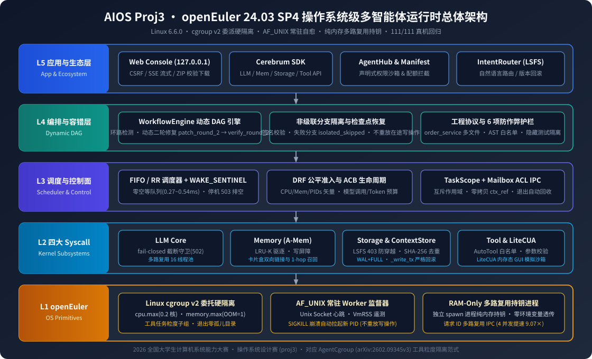

# Agent Runtime / AIOS Proj3

面向多 Agent 的 openEuler 操作系统级运行时：常驻内核、四类系统调用调度、上下文共享与隔离、cgroup v2 资源控制、可视化控制台。

当前发布：**R6.2.1（2026-11-25）**。这是 R6.2 的发布文档与完整性校验修订，运行时代码保持 NUC 验证过的 R6 版本；旧发布和历史代码保留。



- [当前源码、启动方法与能力边界](aios-proj3/README.md)
- [完整交付 ZIP](releases/proj3-r6.2.1-20261125/AIOS-Proj3-R6.2.1-发布修订-20261125.zip)（源码、报告、PPT、NUC 日志与测试证据）
- [答辩 PPT](releases/proj3-r6.2.1-20261125/AIOS-Proj3-答辩PPT.pptx)
- [发布复核与版本绑定说明](releases/proj3-r6.2.1-20261125/PUBLICATION_REVIEW.md)
- [包校验结果](releases/proj3-r6.2.1-20261125/verification.json)

## 快速运行

```bash
cd aios-proj3
python3 -m venv .venv
source .venv/bin/activate
python -m pip install pymupdf pillow
python -m runtime.web --port 8765
```

浏览器打开 http://127.0.0.1:8765/ ，资源与调度控制台位于 `/console/`。网页“模型与 API”保存并选择配置；不要提交密钥。服务固定绑定本地地址。Linux 硬隔离需要 cgroup v2 委派；完整交付 ZIP 内有验收脚本。

## 验证结论

随包原始 NUC 记录：委派阶段 **111/111、0 跳过**，独立 validate_linux 阶段 **110 通过、1 跳过**并另测 CPU、OOM 和零孤儿 cgroup。R6.2.1 不冒称重新做了 NUC 验收：原始 f4cbc 源包保留，新增源码仅更新 README、架构图与来源说明，其余原文件逐字节一致。

固定桩同条件 ABBA 中 Runtime 比直接编排慢约 **6.1%～7.6%**。新增真实调用小样本 token 相同；不同并发的 BFCL/HumanEval 不能用于证明框架提速，HumanEval Runtime 154/164 对直接组 157/164。公开任务实验非官方榜单，桌面控制仍为模拟，未证明所有场景更快、更省或质量不下降。

## 参赛收尾

演示视频百度网盘链接与提取码：**待团队录制上传后填写**。团队贡献签字与临时测试密钥轮换需本人完成。

自研部分采用 [MIT](aios-proj3/LICENSE)，第三方原许可与 [来源说明](aios-proj3/THIRD_PARTY_NOTICES.md) 保留。旧版 `agent_runtime/` 与 `releases/proj3-20261123/` 为历史内容，当前入口是 `aios-proj3/`。
