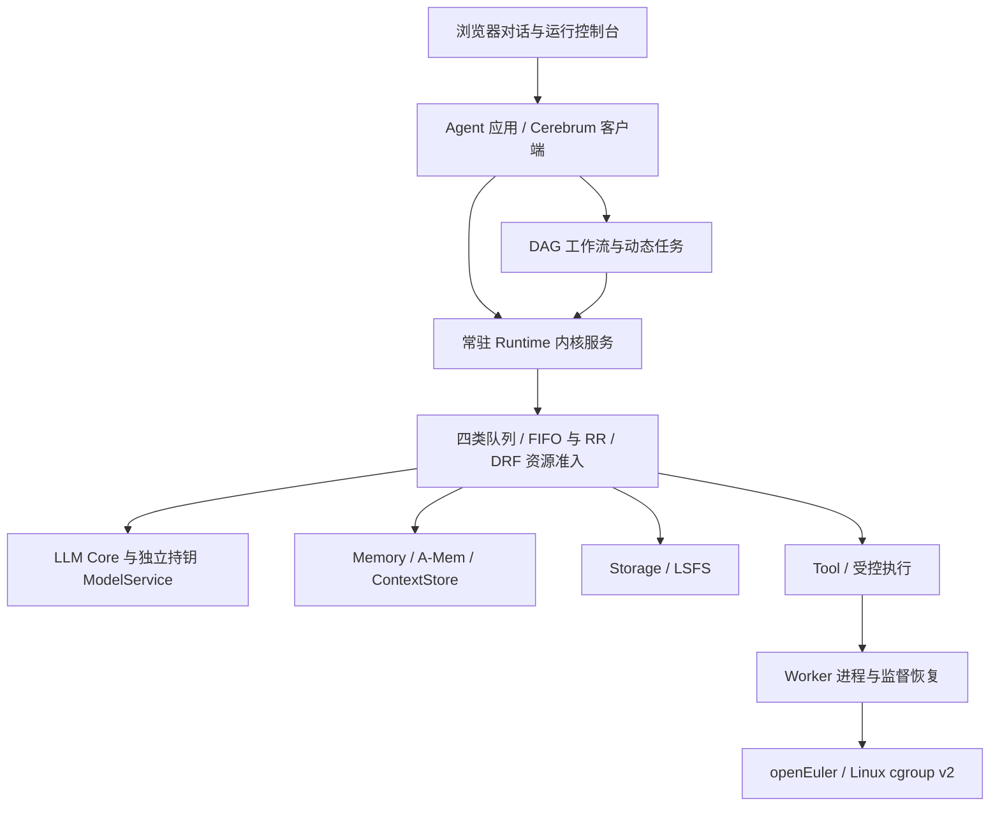

# Agent Runtime · AIOS Proj3

**面向多智能体的操作系统级执行时 · openEuler 实机验证版**

本项目面向全国大学生计算机系统能力大赛操作系统设计赛 Proj3，将多个 Agent 的模型调用、工具执行、上下文和系统资源交给统一 Runtime 管理。它既提供浏览器对话入口，也提供任务编排、资源监控和故障恢复能力。

架构参考 [agiresearch/AIOS](https://github.com/agiresearch/AIOS)，结合 Linux cgroup v2 实现资源硬限制。本项目是参赛团队的独立工程实现，**不是官方 AIOS 发行版**。

> 当前交付：2026-11-23 冻结版。正式代码位于 [`aios-proj3/`](aios-proj3/)，根目录的 `agent_runtime/` 是保留的早期原型。

**[正式源码](aios-proj3/) · [完整交付包与报告](releases/proj3-20261123/) · [答辩 PPT](releases/proj3-20261123/AIOS-Proj3-答辩PPT.pptx) · [NUC 复验日志](releases/proj3-20261123/nuc-final-bound-acceptance-20261123.log) · [赛题原文存档](docs/赛题要求.md)**

## 它解决什么问题

| 多 Agent 执行中的问题 | Runtime 的处理方式 |
| --- | --- |
| 多个任务争抢 CPU、内存和执行槽位 | 统一队列、资源感知准入、DRF 份额管理和老化机制 |
| 长上下文被反复传递、保存 | 内容寻址去重、压缩、预算视图、分页读取和引用传递 |
| 模型、工具、存储接口各自为政 | LLM / Memory / Storage / Tool 四类 Syscall 抽象 |
| 单个工具超时、OOM 或进程崩溃影响全局 | 受控 Worker、cgroup v2、失败分支隔离和有界恢复 |
| 执行过程难以观察和干预 | Web 控制台、Agent 生命周期、DAG、队列及资源状态 |

## 总体架构



这里的“内核”指用户态 Runtime 常驻服务；底层硬限制由 Linux 内核提供。

## 已实现的主要功能

- **Agent 执行管理**：控制块、生命周期、调用与 token 预算、与 Worker 和 OS 资源的关联。
- **任务编排与调度**：DAG 依赖、动态子任务、并发执行、四类请求队列及资源感知准入。
- **上下文与通信**：SHA256 去重、gzip 存储、预算视图、分页、ACL、带确认与幂等控制的 Mailbox IPC。
- **隔离与恢复**：CPU / 内存 / PIDs 限制、OOM 识别、超时回收、检查点、Worker 监督，以及不确定操作的非盲目重放策略。
- **模型接入**：多供应商配置、Chat Completions / Responses 流式协议、纯内存持钥进程隔离；业务子进程环境变量不继承供应商 Key。
- **交互与生态**：对话与监控页面、Markdown / 公式 / 代码显示、文件附件、知识库、工具与 Skill，以及 A-Mem、LSFS、AgentHub 等组件。

实现和实验的具体范围以源码、交付手册及对应测试为准；功能名称不代表与参考论文或第三方协议完全兼容。

## 快速启动

需要 **Python 3.11+**。以下为 Linux / openEuler 命令：

```bash
git clone https://github.com/Tzddd6/agent-runtime.git
cd agent-runtime/aios-proj3
python3 -m venv .venv
source .venv/bin/activate
python -m pip install pymupdf pillow

# 免费本地回归，不需要供应商 API Key
python -B -m unittest discover -s tests -v

# 仅绑定 127.0.0.1
python -m runtime.web --port 8765
```

- 对话工作台：<http://127.0.0.1:8765/>
- 运行控制台：<http://127.0.0.1:8765/console/>
- Windows 使用 `python -m venv .venv` 创建环境，使用 `.venv\Scripts\Activate.ps1` 激活；Linux 硬隔离专项需在 Linux 委派环境运行。
- PyMuPDF、Pillow 用于完整 PDF / 图片附件功能。普通会话的测试可能跳过 Linux 专项，不能据此认定硬隔离验收完成。
- 真实模型交互需另行配置 API，并可能产生费用。不要将密钥写入源码、提交记录或公开日志。

远程访问可用 SSH 转发：

```bash
ssh -L 8765:127.0.0.1:8765 user@host
```

## openEuler 实机验收

下载并解压[完整交付包](releases/proj3-20261123/)，进入包内 `AIOS-Proj3-最终交付候选包/`，按 `02_acceptance/OPEN_EULER_RUNBOOK.md` 准备虚拟环境和 cgroup v2 委派权限，然后执行：

```bash
set -o pipefail
AIOS_PYTHON="$HOME/aios-venv/bin/python3" \
  bash 02_acceptance/FINAL_CHECK.sh 2>&1 \
  | tee "/tmp/aios-acceptance-$(date +%Y%m%d-%H%M%S).log"
```

新日志保存在包外，避免覆盖受 `FILES.sha256` 保护的归档证据。脚本显式向 systemd 传递 Python 绝对路径。

归档的版本绑定复验结果（openEuler 24.03 SP4 / Python 3.11.6）：

| 验证项 | 归档结果 |
| --- | --- |
| 第一阶段完整回归 | **89/89 通过，0 跳过**，10.881 秒 |
| 原生 Worker CPU 限流 | 约 0.1988 核，发生实际节流 |
| 原生 Worker OOM 与回收 | `oom_kill=1`，无孤儿 cgroup |
| 第二阶段重复回归 | 88 通过、1 项委派专项跳过；该专项已在第一阶段通过 |
| 第二阶段独立 CPU / 场景验证 | 约 0.2074 核，复杂场景通过，无残留 cgroup |

完整记录见[最终复验日志](releases/proj3-20261123/nuc-final-bound-acceptance-20261123.log)。耗时是该次运行观测值，不是所有机器上的性能承诺。

## 评测与能力边界

- 交付材料中的 **5 套公开任务子集＋1 套合成压测** 属于受控实验，不能等同于官方完整评测或排行榜排名。
- 不同加速比对应不同基线：旧 Runtime、直接调用以及串并行配置必须分开比较。尚未证明所有场景均更快、更省 token 且质量不下降。
- `LiteCUA / VMController` 当前为**内存态桌面模拟**，用于观测、动作与快照协议验证，不代表已接管 NUC 真实桌面。
- 通过回归测试不代表没有缺陷或绝对安全；进程持钥、ACL 和 cgroup 的保护范围应结合实际配置理解。

## 代码与交付目录

```text
aios-proj3/
├── aios/       # 调度、Syscall、资源与上下文等内核组件
├── cerebrum/   # 客户端与类型化协议
├── runtime/    # 常驻服务、Agent 循环、工作流场景与 Web
├── tests/      # 回归与独立边界测试
├── tools/      # 诊断、Linux 验收和实验脚本
├── examples/   # 端到端示例
└── docs/       # 设计与实现说明
releases/proj3-20261123/  # 原始交付 ZIP、PPT、复验日志和校验摘要
agent_runtime/            # 历史最小原型
docs/                     # 早期赛题与参考资料
```

## 参考与致谢

本项目参考 [AIOS](https://github.com/agiresearch/AIOS) 及 Cerebrum、LSFS、A-Mem、LiteCUA 等工作。公开任务实验涉及 BFCL、HumanEval、MBPP、AgentBench 和 tau2-bench；具体来源、实验配置与边界见交付包报告。第三方代码和资源的许可声明保留在对应目录中。
