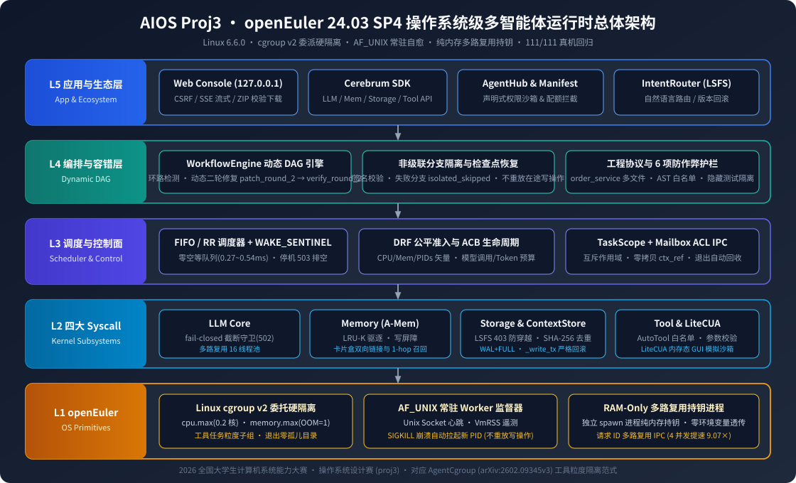

# AIOS Proj3 · 多智能体操作系统级运行时

面向 openEuler 的常驻内核、四类系统调用队列与资源隔离执行环境。R6.2.1 是发布文档与交付校验修订，运行时 Python 代码保持 R6 的版本。



## 已完成

- 常驻 Kernel 与本地/远程 SDK；LLM、工具、记忆、存储四路请求调度。
- Agent 生命周期、DRF 资源准入、Agent/Attempt 双层 cgroup v2 CPU/内存/PIDs 限额。
- AF_UNIX 常驻 Worker、故障隔离与恢复；不盲目重放不确定的写操作或计费请求。
- 上下文内容寻址、压缩、ACL、引用通信与持久存储。
- 白色对话网页与独立控制台：队列、DAG、记忆图谱、资源、模型配置。
- 多文件订单项目修复：原始失败 → 补丁 → 真实测试 → 下载含公开测试的项目。

## 运行

Python 3.11+；完整 PDF/图片附件功能及相关测试需安装可选依赖：

```bash
python3 -m venv .venv
source .venv/bin/activate
python -m pip install pymupdf pillow
python -m runtime.web --port 8765
```

打开 http://127.0.0.1:8765/ （对话）或 http://127.0.0.1:8765/console/ （控制台）。服务固定绑定本地地址；远程访问可用 SSH 本地端口转发。在网页“模型与 API”保存并选择配置；供应商密钥仅由独立模型服务进程内存持有，重启后重新输入。不要把密钥写进源码、日志或截图。

```bash
python -B -m unittest discover -s tests -v
python tools/doctor.py
```

Linux 硬隔离测试需要 cgroup v2 委派，普通 Windows/未委派会话的跳过不等于实机验收。交付 ZIP 的 `02_acceptance/FINAL_CHECK.sh` 提供委派验收入口，日志写在包外。

## 证据与性能边界

- 随包 R6 NUC 记录：第一阶段 111/111、0 跳过；独立 validate_linux 阶段 110 通过、1 项跳过，并另外验证 CPU 节流、真实 OOM 与退出后无孤儿 cgroup。
- 原始 NUC 源包 SHA-256：`f4cbc22d4b64a348726f9860cdc13f2c6162e0eee91fef33dead263237b8a1c8`。发布修订没有重跑 NUC，使用逐文件比对证明运行时代码未变；不能把新 ZIP 的整体哈希称为旧日志的验收对象。
- 同持久性、固定响应桩、单并发、四工程 ABBA 观测：Runtime 仍比直接编排慢约 6.1%～7.6%；不产生真实计费 token。
- 新增真实调用对照只有少量样本。BFCL/HumanEval 扩量组使用不同并发（6 对 2），不作为同条件速度优势；HumanEval 为 154/164 对 157/164，质量未证明不下降。
- 5 套公开任务子集 + 1 套合成压测为自托管实验，非官方榜单。桌面 LiteCUA/VMController 仍为模拟；工程修复入口主要覆盖内置受控项目，非任意项目修复保证。

完整报告、答辩 PPT、原始 JSON、浏览器下载复测及 NUC 日志在仓库的 [交付资料](../releases/proj3-r6.2.1-20261125/)；独立源码 ZIP 不含该同级目录，请使用完整交付包。架构参考 [AIOS](https://github.com/agiresearch/AIOS)，不是官方兼容性或官方成绩声明。

## 演示视频与许可

演示视频链接、提取码：待团队录制后填写，尚未交付视频。团队贡献与签字也需本人核对。

自研代码采用 [MIT](LICENSE)，第三方组件保留原许可，见 [来源说明](THIRD_PARTY_NOTICES.md)。
