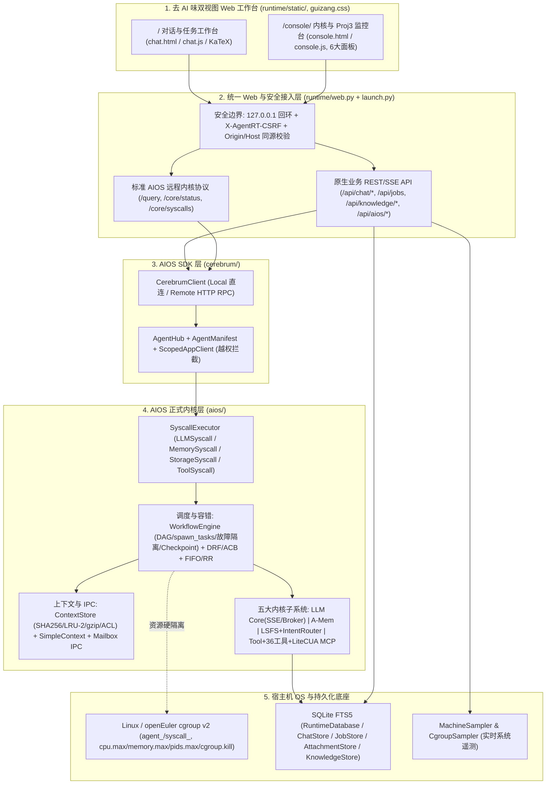
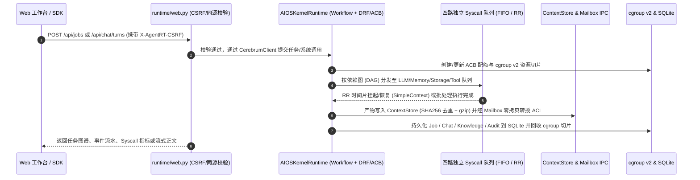

# AIOS 新版统一架构与“去 AI 味”控制台设计方案

> **适用赛题**：2026 年全国大学生计算机系统能力大赛（操作系统设计赛—中西部与华南区域赛—功能挑战赛道）**`proj3`：面向多智能体的操作系统级执行时（Agent Runtime）**  
> **目标主仓**：`d:\gemini\aios`  
> **设计基线**：`agiresearch/AIOS`（六篇系列顶会论文） + 原项目 `agent-runtime-aios (v0.25)` 全量产品与 OS 能力 + `op7418/dsh-guizang-design` 去 AI 味设计规范

---

## 一、设计目标与核心定位

新版架构旨在解决此前两个工作区的结构性割裂（工作区 A 有原生模块与新 UI 草稿但未接通 Web 服务；工作区 B 通过 `compat/` 兼容层双轨运行但业务与正式内核分离），实现 **“单内核、单数据面、100% 原功能原生覆盖、统一去 AI 味控制台”**：

1. **对上对齐官方 AIOS 正式架构**：常驻 Kernel + `Cerebrum` SDK 解耦 + 四路独立 Syscall 队列（LLM / Memory / Storage / Tool）+ 六篇核心论文生态完整落地（AIOS、Cerebrum、LSFS、A-Mem、LiteCUA、Agents as Apps）。
2. **对下保留 OS 赛题硬核底座**：保留并强化 openEuler / Linux `cgroup v2` 双层委派隔离（已通过 NUC 实机 0.2 核节流与零残留验收）、DRF 主导资源公平 + Aging 防饥饿、`AgentControlBlock` 完整生命周期、DAG 动态派生与故障分支隔离、SHA256 内容寻址上下文去重/gzip 压缩/ACL 隔离、以及零拷贝 Mailbox IPC。
3. **100% 覆盖旧版 v0.25 产品能力**：聊天流式增量、附件与文档解析、SQLite FTS5 知识库、纯内存多供应商持钥、36 工具与 17 Skill、受控 Python 工程七阶段修复闭环全部**原生走 AIOS Kernel Syscall**，彻底移除 `compat/` 双轨。
4. **“去 AI 味”专业系统控制台**：参考 `op7418/dsh-guizang-design` 的**电子杂志排版 × 瑞士国际主义细线网格**，将对话工作台（`/`）与内核监控台（`/console/`）统一在同一套克制、高密度的工程设计语言下。

---

## 二、新版统一分层架构

### 2.1 静态五层架构图

### 2.2 核心执行链路（请求 → 调度 → 零拷贝通信 → 落盘）

---

## 三、旧版 v0.25 → 新版 AIOS 100% 功能迁移矩阵

| 能力域 | 旧版 v0.25 行为 | 新版原生落点（`d:\gemini\aios`） | 当前状态 |
| :--- | :--- | :--- | :--- |
| **常驻内核与远程 SDK** | 单次 Workflow 执行，非标准 Cerebrum 协议 | [launch.py](file:///d:/gemini/aios/runtime/launch.py)、[web.py](file:///d:/gemini/aios/runtime/web.py)、[client.py](file:///d:/gemini/aios/cerebrum/client.py)、[syscall.py](file:///d:/gemini/aios/aios/syscall/syscall.py) | 已完成 |
| **openEuler cgroup v2 实机隔离** | 双层委派树与 CPU/内存/PID 限额 | [cgroup_v2.py](file:///d:/gemini/aios/aios/os_kernel/cgroup_v2.py)、[validate_linux.py](file:///d:/gemini/aios/tools/validate_linux.py)、[test_native_linux.py](file:///d:/gemini/aios/tests/test_native_linux.py) | 已通过 NUC openEuler 24.03 实机全量验收（53/53） |
| **调度、DAG 与容错（4.2/4.3/4.4）** | DAG 依赖、动态任务、DRF/Aging、故障隔离、Checkpoint | [workflow_engine.py](file:///d:/gemini/aios/aios/scheduler/workflow_engine.py)、[drf_admission.py](file:///d:/gemini/aios/aios/scheduler/drf_admission.py)、[rr_scheduler.py](file:///d:/gemini/aios/aios/scheduler/rr_scheduler.py) | 已完成并接入 Web 控制接口 |
| **上下文复用/压缩/隔离与 IPC（4.5/4.7）** | SHA256 去重、gzip + 预算裁剪、ACL、Mailbox 零拷贝 | [context_store.py](file:///d:/gemini/aios/aios/context/context_store.py)、[mailbox.py](file:///d:/gemini/aios/aios/ipc/mailbox.py) | 已完成并在控制台展示 |
| **真实流式 SSE 与纯内存持钥** | Chat Completions / Responses 双协议 + 密钥不落盘 | [sse.py](file:///d:/gemini/aios/aios/llm_core/sse.py)、[streaming.py](file:///d:/gemini/aios/aios/llm_core/streaming.py)、[profiles.py](file:///d:/gemini/aios/aios/llm_core/profiles.py) | 已完成并接入 `/api/model-profiles/*` |
| **对话历史、附件与文档解析** | 多会话存储、文件上传解析、增量问答 | [chat_store.py](file:///d:/gemini/aios/aios/storage/chat_store.py)、[attachments.py](file:///d:/gemini/aios/aios/storage/attachments.py)、[document_parser.py](file:///d:/gemini/aios/aios/storage/document_parser.py) | 已完成并接入 `runtime/web.py` |
| **双语 FTS5 知识库** | 文档增删查、分块索引、行号引用标注 | [knowledge.py](file:///d:/gemini/aios/aios/storage/knowledge.py)、[database.py](file:///d:/gemini/aios/aios/storage/database.py) | 已完成并接入 `runtime/web.py` |
| **36 工具 / 17 Skill / 工程修复闭环** | 32+ 工具目录、Skill 检索、Python 七阶段修复测试 | [catalog.py](file:///d:/gemini/aios/aios/tool/catalog.py)、[library.py](file:///d:/gemini/aios/aios/tool/library.py)、[engineering.py](file:///d:/gemini/aios/aios/tool/engineering.py) | 已完成并接入 `/api/jobs` 与对话工作台 |
| **AIOS 六篇论文特色能力** | 无（新版核心增量） | A-Mem（[amem.py](file:///d:/gemini/aios/aios/memory/amem.py)）、LSFS（[lsfs.py](file:///d:/gemini/aios/aios/storage/filesystem/lsfs.py) + [intent_router.py](file:///d:/gemini/aios/aios/terminal/intent_router.py)）、LiteCUA（[desktop_env.py](file:///d:/gemini/aios/aios/tool/virtual_env/desktop_env.py)）、AgentHub（[hub.py](file:///d:/gemini/aios/cerebrum/hub.py)） | 已完成并全量暴露至 `runtime/web.py` |
| **去 AI 味统一 Web 控制台** | 旧版两套样式割裂 | [guizang.css](file:///d:/gemini/aios/runtime/static/guizang.css)、[console.html](file:///d:/gemini/aios/runtime/static/console.html)、[chat.html](file:///d:/gemini/aios/runtime/static/chat.html) + [runtime/web.py](file:///d:/gemini/aios/runtime/web.py) | 已完成联调与验收 |

---

## 四、统一 Web 服务端设计（`runtime/web.py`）

新增 `runtime/web.py` 作为统一本地工作台入口（`python -m runtime.web --port 18890`），同时保留 `runtime/launch.py` 纯内核服务兼容。

### 4.1 安全与运行边界
- **网络绑定**：默认仅绑定 `127.0.0.1`，不向公网暴露。
- **写操作防护**：所有 `POST` 业务接口强制校验 `X-AgentRT-CSRF`（由 `/api/status` 与 `/api/chat/status` 下发）以及 `Origin` / `Host` 同源检查；单次请求体严格限长（普通 JSON ≤ 1 MiB，附件上传 ≤ 10 MiB）。
- **静态资源防穿越**：`/static/*` 使用 `Path.resolve()` 严格约束在 `runtime/static/` 目录内，拒绝 `..` 与非法路径。
- **密钥隔离**：模型供应商密钥仅存于 `ModelProfileBroker` 进程内存中，严禁写入 SQLite、日志或前端响应。

### 4.2 核心路由与接口契约

| 分组 | 方法与路径 | 功能说明 |
| :--- | :--- | :--- |
| **页面与静态资源** | `GET /`、`GET /console`、`GET /static/<path>` | 分别返回 `chat.html`、`console.html` 及样式/脚本/KaTeX 字体 |
| **内核标准协议** | `POST /query`、`GET /core/status`、`GET /core/syscalls` | 与 `CerebrumClient` 远程模式 100% 兼容 |
| **控制台全局状态** | `GET /api/status` | 返回 `csrf`、`enforcement`、`model`、`kernel_status`（含 DRF、ContextStore、队列）、`machine`（遥测）、`syscalls`、`jobs` |
| **论文生态聚合** | `GET /api/aios/ecosystem` | 返回 `amem_notes`、`litecua_state`、`agent_hub_apps`、`capabilities`（36 工具 + 17 Skill）、`model_profiles` |
| **工作流与 10 类 Preset** | `POST /api/jobs`、`GET /api/jobs`、`GET /api/jobs/<id>` | 支持 `kernel` / `engineering` / `dynamic` / `agents` / `resources` / `ipc` / `document` / `litecua` / `llm` / `team` 十类预设，全部经 `AIOSKernelRuntime` 执行并落盘 `JobStore` |
| **Agent 生命周期控制** | `POST /api/aios/agents/<name>/<op>` | `op` 支持 `pause` / `resume` / `terminate`，直接操作 `DRFAdmissionController` 与 ACB 状态机 |
| **对话与附件** | `GET /api/chat/status`、`GET /api/chat/conversations`、`GET /api/chat/conversations/<id>`、`POST /api/chat/turns`、`POST /api/attachments` | 支持 `auto` / `team` / `engineering` / `lsfs` 四种模式、知识库引用注入（`citations`）、附件解析与 SQLite 持久化 |
| **知识库与 A-Mem** | `GET /api/knowledge`、`GET /api/knowledge/search?q=`、`POST /api/knowledge/save`、`POST /api/knowledge/remove`、`POST /api/memory/save` | 驱动 SQLite FTS5 双语检索与 A-Mem 卡片盒双向建链演化 |
| **模型持钥配置** | `POST /api/model-profiles/save`、`POST /api/model-profiles/select`、`POST /api/model-profiles/remove` | 运行时热配置/切换 DeepSeek、OpenAI、Aizex、Ollama、vLLM |
| **LSFS 与 LiteCUA** | `POST /api/aios/intent`、`POST /api/aios/litecua` | `IntentRouter` 自然语言文件指令执行；LiteCUA 五类 GUI/快照动作（`observe` / `click_search` / `type_query` / `hotkey_run` / `restore_boot`） |

---

## 五、“去 AI 味”控制台视觉与交互规范

严格对标 `op7418/dsh-guizang-design`，已在 [guizang.css](file:///d:/gemini/aios/runtime/static/guizang.css) 落地以下核心规则：

1. **视觉去 AI 味铁律**：
   - **禁用**：紫蓝霓虹渐变、发光卡片阴影、大圆角毛玻璃、无意义 Emoji 图标堆砌。
   - **采用**：`1px` 细线网格（Hairline Grid）、`0px–2px` 利落边角、高对比纸墨底色、明确的左边框状态色条（`3px solid`）。
2. **双排版体系**：
   - 标题采用中文衬线体（`Source Han Serif SC` / `Noto Serif CJK SC`）塑造编辑杂志质感；
   - 正文采用高可读无衬线体，所有数值/延迟/配额/SHA256 强制 `JetBrains Mono` + `tabular-nums` 等宽对齐。
3. **四套克制主题一键切换**（持久化至 `localStorage`）：
   - `ink-classic`（默认 · 宣纸米白 `#f7f5f0` + 墨黑 + 朱砂红 `#c83e2b`）
   - `swiss-ikb`（瑞士国际主义 · 纯白 + 国际克莱因蓝 `#002fa7` + 安全橙 `#ff4f00`）
   - `forest-ink`（松烟墨绿 `#f2f5f3` + 深松绿 `#1b4332`）
   - `midnight-ink`（子夜墨色深色模式 `#111317` + 暖琥珀 `#e07a2e`）
4. **双视图信息架构**：
   - **`/`（对话与任务工作台）**：左侧会话与记忆/知识库计数导航，右侧杂志排版对话流（支持 Markdown + KaTeX 公式 + 知识库行号引用徽标 + 模式切换）。
   - **`/console/`（内核运行控制台）**：顶部 4 项硬核 KPI（DRF CPU 配额、内存上限、ContextStore 物理压缩节省率、累计 Syscall 数）+ 左侧 6 大功能面板：
     - `01 协作与工程修复`（10 类 Preset 启动器 + DAG 节点终态/SHA256 表 + 工程修复前后代码 Diff 与 7 阶段测试收据）
     - `02 内核队列与系统调用`（ContextStore 逻辑/物理/去重指标 + 实时 Syscall 延迟流水表）
     - `03 Agent 控制块与生命周期`（ACB 卡片 + 状态轨迹 + 在线暂停/恢复/终止）
     - `04 A-Mem 记忆图谱与知识库`（卡片盒演化次数/标签/双向链接 + FTS5 知识检索与录入）
     - `05 LSFS 终端与 LiteCUA 桌面`（自然语言文件终端 + 无障碍树焦点高亮与快照回滚）
     - `06 Cerebrum 应用与能力库`（AgentHub Manifest 配额卡片 + 36 工具/17 Skill 实时过滤 + 模型持钥配置）

---

## 六、分阶段实施与验收标准

| 阶段 | 核心任务 | 验收标准 |
| :--- | :--- | :--- |
| **阶段 1：双仓合龙** | 同步工作区 B 的 `cgroup_v2.py` NUC 修复、测试补丁与 `--cgroup-root` | **已完成** |
| **阶段 2：构建 `runtime/web.py`** | 实现统一 Web 控制器、CSRF/同源保护、10 类 Preset 原生调度与全量 `/api/*` + `/query` | **已完成**（含 LiteCUA、AgentHub、知识库移除与遥测接入） |
| **阶段 3：前端全量联调与补强** | 联调 `chat.html` / `console.html`，补齐聊天 Markdown/KaTeX 渲染、附件上传、LiteCUA 交互与 10 类场景 | **已完成** |
| **阶段 4：回归测试与真机验收** | 全量 53 项单元与集成测试回归；在 openEuler NUC 复跑 `test_native_linux.py` 与 `validate_linux.py` | **已完成**（NUC 53/53 全绿 + `validate_linux.py` 0.2019 核/20 次节流/OOM=1/零残留，见 [NUC实机验收-2026-11-23.md](file:///d:/gemini/aios/docs/NUC实机验收-2026-11-23.md)） |
