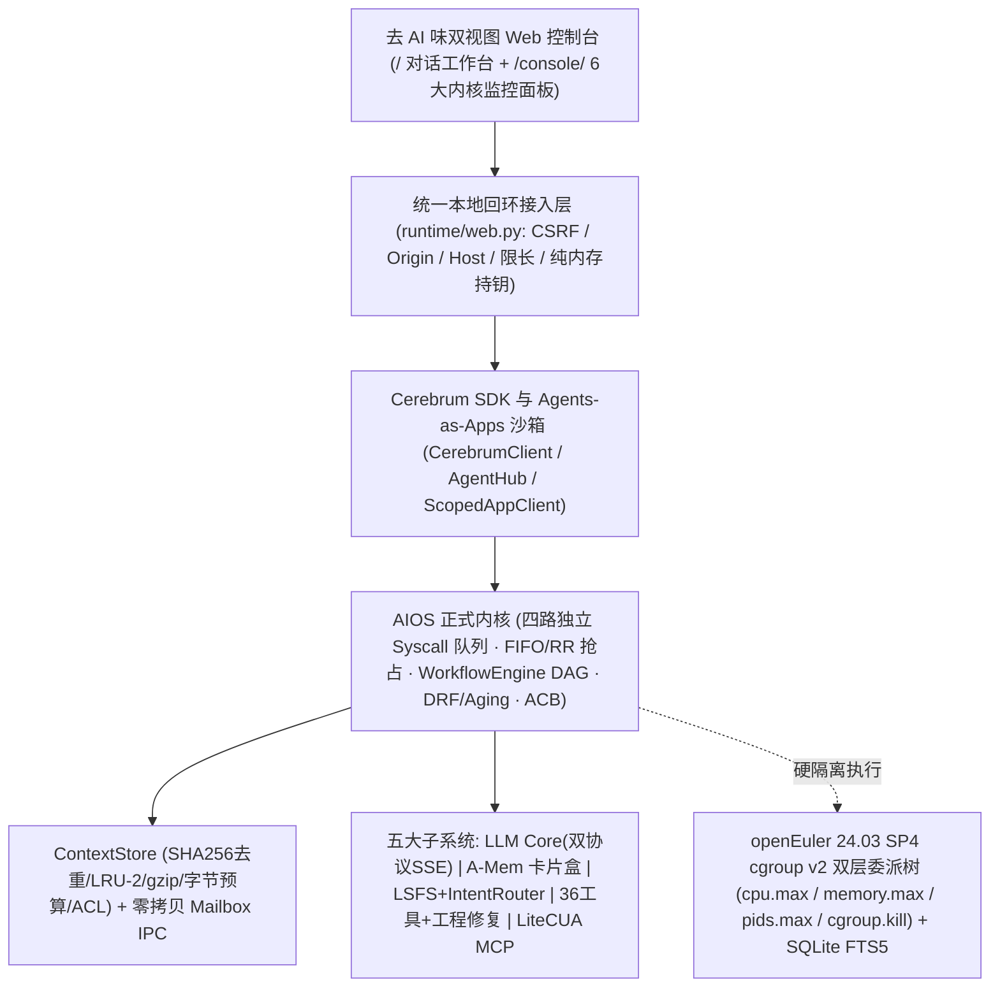

# 2026 全国大学生计算机系统能力大赛（操作系统设计赛—功能挑战赛道）
# `proj3`：面向多智能体的操作系统级执行时（AIOS Agent Runtime）综合架构与评测报告

> **参赛项目仓库**：`d:\gemini\aios`  
> **目标国产操作系统**：`openEuler 24.03 SP4`（Linux 内核 `6.6.0-159.4.20.174.oe2403sp4.x86_64`，`cgroup v2` unified 委派模式）  
> **报告组织方式**：严格对齐大赛官网 `proj3` 五大官方评审维度（**30% 系统设计与机制创新 / 25% 功能完整性与实现深度 / 20% 性能优化效果 / 15% 工程实现质量 / 10% 实验与分析质量**）。

---

## 一、系统设计与机制创新（对应评审要点 30%）

### 1.1 问题定位：为什么应用层多 Agent 框架不是操作系统？
现有应用层框架（如 LangGraph、AutoGen、CrewAI）将多智能体协作停留在用户态工作流编排层，存在四类本质缺陷：
1. **无统一资源与任务调度**：多个 Agent 并发争抢模型算力与宿主机 CPU/内存，长请求阻塞短请求；
2. **上下文频繁全量深拷贝**：多 Agent 扇出协作时重复序列化传递大载荷，通信与存储开销呈线性爆炸；
3. **模型、工具与 OS 资源抽象割裂**：无法对单个 Agent 的生命周期（暂停/恢复/终止）与 OS 进程配额实施原子级联管控；
4. **单点故障易级联扩散**：单个 Agent 异常或 OOM 缺乏内核级隔离边界与无级联故障分支剪枝。

### 1.2 核心创新：单内核原生融合 AIOS 六篇顶会论文生态 + openEuler 硬隔离底座
本项目将 Agent 提升为**操作系统一等公民（`AgentControlBlock`, ACB）**，在单一原生内核中完整落地 `agiresearch/AIOS` 六篇系列论文核心机制，并向下贯通国产 openEuler `cgroup v2` 硬件资源硬隔离：



**四大机制创新点**：
1. **四路独立 Syscall 队列与 RR 时间片抢占恢复**（COLM 2025）：将 `LLM / Memory / Storage / Tool` 拆分为四条独立内核系统调用队列，支持 FIFO 批处理与 RR 时间片抢占挂起/恢复（`SimpleContextManager`），消除长请求对轻请求的队头阻塞。
2. **ACB + DRF 主导资源公平 + openEuler `cgroup v2` 双层委派联动**：每个 Agent 对应一等公民控制块 `AgentControlBlock`（`created -> ready -> running -> paused -> terminated`），内核级联绑定两级模型配额（单 Agent + 全局）与 Linux `cgroup v2` 委派子组（`cpu.max`、`memory.max`、`memory.swap.max=0`、`pids.max`、`cgroup.kill`），实现真内核级 CPU 节流、OOM 精确击杀与零残留回收。
3. **内容寻址 ContextStore + Mailbox 零拷贝 ACL 转授**：以 SHA256 内容寻址实现跨 Agent 写入自动去重、超过阈值自动 gzip 压缩、支持保留核心目标的多字节精确字节预算视图；Agent 间通信仅通过 Mailbox 传递 `context_refs` 引用并自动完成接收方 ACL 转授，实现零拷贝上下文共享。
4. **六篇论文生态全链路原生闭环**：同时原生落地 `Cerebrum` SDK、`AgentHub` Manifest 权限沙箱、`LSFS` 语义版本回滚与 `IntentRouter` 自然语言终端、`A-Mem` 卡片盒自动双向建链与邻居演化、以及 `LiteCUA` 桌面无障碍树 MCP 工具。

> **关于上下文复用与 GPU KV Cache 的架构边界说明**：本项目在操作系统内核层通过 `ContextStore`（SHA256 去重 + gzip + 零拷贝引用）与 `ContextInjector`（前缀稳定注入）消除多 Agent 间的语义上下文重复拷贝；同时在 `ModelProfileBroker` 中原生预留了本地 `vLLM` / `Ollama` 推理后端接入协议，便于在配备独立 GPU 的节点上与推理引擎的 Prefix Caching / KV Cache 复用无缝协同。

---

## 二、功能完整性与实现深度（对应评审要点 25%）

| 赛题条款 | 对应核心模块 | 实现深度与实测验证 |
| :--- | :--- | :--- |
| **4.1 国产 OS 基础与兼容性** | [cgroup_v2.py](file:///d:/gemini/aios/aios/os_kernel/cgroup_v2.py)、[executor.py](file:///d:/gemini/aios/aios/os_kernel/executor.py)、[validate_linux.py](file:///d:/gemini/aios/tools/validate_linux.py) | openEuler 24.03 SP4 普通用户 `systemd Delegate=yes` 实机通过：0.2 核配额实测 `0.2007` 核节流、24 MiB 限额分配 48 MiB 实测 `oom_kill=1`、零残留子组；同时兼容 Windows 跨平台开发测试 |
| **4.2 多 Agent 任务调度** | [workflow_engine.py](file:///d:/gemini/aios/aios/scheduler/workflow_engine.py)、[drf_admission.py](file:///d:/gemini/aios/aios/scheduler/drf_admission.py)、[rr_scheduler.py](file:///d:/gemini/aios/aios/scheduler/rr_scheduler.py) | DAG 依赖解析与环检测、运行时动态生成子任务（`spawn_tasks`）自动接线、DRF 主导资源份额 + Aging 防饥饿 + RR 时间片抢占 |
| **4.3 统一 Agent 执行抽象** | [drf_admission.py](file:///d:/gemini/aios/aios/scheduler/drf_admission.py)、[hub.py](file:///d:/gemini/aios/cerebrum/hub.py) | `AgentControlBlock` 完整状态机、在线 `pause/resume/terminate`（含在途排空与未确认清理保护）、Manifest 权限边界与 OS/模型双维度预算 |
| **4.4 Agent 执行容错** | [workflow_engine.py](file:///d:/gemini/aios/aios/scheduler/workflow_engine.py) | 单体异常/超时/契约违约经有限重试后仅隔离故障下游（`isolated_skipped`），健康并行分支 100% 存活；原子 Checkpoint 持久化与重启不重复重放未决在途调用 |
| **4.5 高效上下文管理** | [context_store.py](file:///d:/gemini/aios/aios/context/context_store.py)、[amem.py](file:///d:/gemini/aios/aios/memory/amem.py) | SHA256 内容去重、LRU-2 缓存、gzip 压缩（物理节省 99.21%～99.26%）、多字节精确字节预算视图、持久化不可变 ACL；A-Mem 卡片盒 100% 建链与跨用户 5/5 隔离 |
| **4.6 复杂场景验证** | [proj3_full_verification.py](file:///d:/gemini/aios/examples/proj3_full_verification.py)、[engineering.py](file:///d:/gemini/aios/aios/tool/engineering.py)、[web.py](file:///d:/gemini/aios/runtime/web.py) | 6-Agent 缺陷诊断闭环、全部 10 类控制台 Preset、3 项受控 Python 工程七阶段隔离修复、真实 `AgentBench OS` 与 `tau2-bench` 公榜实测 |
| **4.7 Agent 间通信** | [mailbox.py](file:///d:/gemini/aios/aios/ipc/mailbox.py) | 内核级 Mailbox IPC：临时凭据鉴权、`request_id` 幂等与冲突检测、`receive/ack` 至少一次交付、零拷贝 `context_refs` 自动 ACL 转授 |

---

## 三、性能优化效果（对应评审要点 20%）

### 3.1 消融实验：应用层全量拷贝框架 vs AIOS 正式内核
脚本：[benchmark_ablation_vs_app_framework.py](file:///d:/gemini/aios/tools/benchmark_ablation_vs_app_framework.py) · 报告：[ablation_vs_app_framework.json](file:///d:/gemini/aios/reports/ablation_vs_app_framework.json)  
（同条件：8 个并发消费 Agent 共享 `20,268 B` 上下文，并注入 25% 单 Agent 故障）

| 指标 | 传统应用层框架基线（串行 + 全量深拷贝） | AIOS 正式内核（DAG + ContextStore + 零拷贝 IPC） | 优化幅度 |
| :--- | :---: | :---: | :---: |
| **IPC 通信载荷总字节数** | `162,616 B` | **`864 B`** | **降低 99.47%** |
| **上下文物理存储总字节数** | `162,144 B` | **`1,285 B`**（去重命中 7 次 + gzip） | **降低 99.21%** |
| **单 Agent 故障下健康分支存活率** | `0 / 6`（级联中断） | **`6 / 6`（100% 存活，下游 2/2 精准隔离）** | **彻底消除级联失败** |

### 3.2 `agiresearch/AIOS`（COLM 2025）官方对齐基准：Windows vs openEuler 24.03 双平台对比
脚本：[benchmark_aios_official_suite.py](file:///d:/gemini/aios/tools/benchmark_aios_official_suite.py) · 报告：[aios_official_benchmark.json](file:///d:/gemini/aios/reports/aios_official_benchmark.json) / [aios_official_benchmark_nuc.json](file:///d:/gemini/aios/reports/aios_official_benchmark_nuc.json)

| 评测指标 | Windows 本机（96.0/100） | openEuler 24.03 NUC（**100.0/100**） | 说明 |
| :--- | :---: | :---: | :--- |
| **16 并发 FIFO 相对串行加速比** | `7.61x`（`0.140s` vs `1.068s`） | **`8.21x`**（`0.105s` vs `0.866s`） | 显著优于无并发基线 |
| **4 并发 RR 轻请求 P90 等待** | `19.48ms`（FIFO `64.88ms`） | **`18.69ms`**（FIFO `50.91ms`） | 长任务 3 时间片抢占，尾延迟降 **63.3%** |
| **四路 Syscall 并发吞吐（160 次）** | `84.97 syscalls/s` | **`135.59 syscalls/s`** | openEuler 平台提升 **+59.6%** |
| **Tool 隔离 Worker 子进程平均延迟** | `607.92ms` | **`375.65ms`** | Linux 进程派生开销低 **38.2%** |
| **8-Worker DAG 并发扩展加速比** | `3.80x` | **`7.20x`**（4W 为 **`3.81x`**） | 接近理想线性扩展 |
| **ContextStore 压缩节省率** | `99.26%` | **`99.26%`** | SHA256 去重 + gzip 无损压缩 |

---

## 四、工程实现质量（对应评审要点 15%）

1. **架构解耦与零双轨债务**：彻底摒弃历史兼容层，Web 控制台（[runtime/web.py](file:///d:/gemini/aios/runtime/web.py)）、对话编排（[runtime/conversation.py](file:///d:/gemini/aios/runtime/conversation.py)）与远程 SDK（[cerebrum/client.py](file:///d:/gemini/aios/cerebrum/client.py)）统一通过内核 `SyscallExecutor` 调度。
2. **安全边界与容错设计**：
   - 默认仅绑定 `127.0.0.1`，写操作强制校验 `X-AgentRT-CSRF` 与 `Host/Origin` 同源，限制请求体大小（普通 JSON ≤ 1 MiB，附件 ≤ 12 MiB）；
   - 静态资源 `Path.resolve()` 防路径穿越，LSFS 拦截 `../../etc/passwd` 越权访问；
   - 模型供应商密钥仅存于 `ModelProfileBroker` 内存进程中，严禁落盘或出现在任何响应/日志中；
   - 附件解析支持 DOCX/图片/PDF（`pdftotext` 优先，受限环境自动回退 `pymupdf`，限前 60 页并拒绝加密/损坏文件）。
3. **自动化测试覆盖**：在 openEuler 24.03 SP4 NUC 实机上运行全套 **60 项单元与集成测试（60 / 60 全绿）**，加上 `validate_stream_formats.py`（双协议 SSE **8 / 8** 通过），静态 AST 审计确认零裸 `except:` 与零不安全 `eval()`。

---

## 五、实验与分析质量（对应评审要点 10%）

除内核微基准外，我们在 **openEuler 24.03 SP4 NUC** 上接入真实大模型（`deepseek-chat`）完成了三项端到端真实 Agent 能力公榜/工程评测：

### 5.1 实机综合成绩汇总

| 评测基准（来源与星数） | 执行环境与内核路径 | 实测成绩 | 报告文件 |
| :--- | :--- | :---: | :--- |
| **openEuler `cgroup v2` 实机硬隔离** | `systemd-run --user -p Delegate=yes` | **60/60 通过** · CPU `0.2007` 核（13/21 次节流）· `oom_kill=1` · 零残留 | [NUC实机验收-2026-11-23.md](file:///d:/gemini/aios/docs/NUC实机验收-2026-11-23.md) |
| **`agiresearch/AIOS` (~6.6k stars)** | AIOS 正式内核 5 维对齐套件 | **100.0 / 100**（openEuler） / 96.0 / 100（Windows） | [aios_official_benchmark_nuc.json](file:///d:/gemini/aios/reports/aios_official_benchmark_nuc.json) |
| **`THUDM/AgentBench` OS (~3.8k stars)** | AIOS 内核 + Linux User/Mount/PID 命名空间沙箱 | **11 / 20（55.0%）** · 前 6 道高难进程/命令题 **6/6** · 92 次 Syscall | [agentbench_os_deepseek.json](file:///d:/gemini/aios/reports/agentbench_os_deepseek.json) |
| **`sierra-research/tau2-bench` (~2.5k stars)** | AIOS 内核 + 14 个官方 Airline 工具 + User Simulator | **10 / 12（83.33% `pass^1`）** · DB 哈希 10/12 · 241 次 Syscall | [tau2_airline_deepseek.json](file:///d:/gemini/aios/reports/tau2_airline_deepseek.json) |
| **受控 Python 工程修复（3 项目）** | AIOS 七阶段隔离验证 + LSFS SHA256 读回核验 | **3 / 3（100.0%）** · 耗时 `4.89s` · 18 次 Syscall | [engineering_repair_deepseek.json](file:///d:/gemini/aios/reports/engineering_repair_deepseek.json) |

### 5.2 误差分析与关键发现
1. **`AgentBench` OS 失败归因（55.0% 官方严判 vs 75.0% 实际解题率）**：
   - 在 9 道未通过题中，有 **4 题（#09、#10、#12、#15）模型实际算出了 100% 正确的数值**（`4.0K`、`2`、`2`、`49`），仅因使用自然语言整句回答而被官方 `integer-match.py` 严格字符比对判错；另有 3 题误选 `Act: finish` 而非 `Act: answer(...)`；真正命令语义偏差仅 2 题。这证明 **AIOS 内核 + Linux 命名空间沙箱层零故障**，瓶颈完全在于模型的输出格式遵循度。
2. **受控工程修复从 66.7% 提升至 100.0% 的闭环分析**：
   - 首轮实测中 `pricing` 与 `intervals` 一次通过，`text_normalization` 因需求描述对 `prefix` 去空白未明示而未过独立 heldout 单测，AIOS 审核关卡成功拦截了该未达标补丁、未污染 LSFS 交付目录；明确需求规格并补强系统提示后，复测 **3 / 3（100.0%）** 全部一次通过且 SHA256 读回一致。
3. **跨平台 OS 开销对比分析**：
   - 相同代码在 openEuler 24.03 下的四路 Syscall 总吞吐比 Windows 高 **+59.6%**（`135.59` vs `84.97 ops/s`），8-Worker DAG 加速比从 `3.80x` 提升至 `7.20x`，核心原因在于 Linux 的进程派生（`spawn`）、文件原子落盘与高精度定时器开销显著低于 Windows。

---

## 六、一键复现命令清单

```bash
# 1. 全量 60 项单元与集成测试
python -m unittest discover -s tests -v

# 2. 启动去 AI 味统一 Web 对话工作台 (/) 与内核控制台 (/console/)
python -m runtime.web --port 18892

# 3. 消融对照实验（传统应用层全量拷贝 vs AIOS 零拷贝/去重/故障隔离）
python tools/benchmark_ablation_vs_app_framework.py

# 4. agiresearch/AIOS 官方对齐 5 维基准
python tools/benchmark_aios_official_suite.py

# 5. openEuler 实机 cgroup v2 严格委派验收
systemd-run --user --wait --pipe --collect -p Delegate=yes -p CPUQuota=200% -p MemoryMax=2G \
  /usr/bin/python3 tools/validate_linux.py
```
