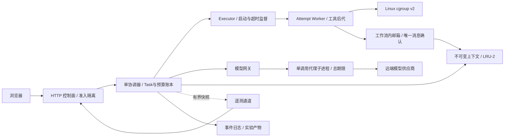

# 架构审查：单机 Runtime 的执行与控制边界

审查对象是当前单机、可信 Agent 模板、openEuler+cgroup v2 的参赛开发版。审查结合源码和最小复现，不把常规测试通过等同于所有边界正确，也不将特定负载优化外推为架构普遍最优。

## 结论

保留“一个协调器拥有任务状态和预留账本，独立 Worker 执行，OS cgroup 强制限额”的主结构。它能避免多处同时修改调度状态，当前规模不需要为了分层而引入分布式队列或数据库锁。

发现的问题主要在监督和故障边界，而不是 DAG 这个抽象本身。对这些边界应有监督线程/模型代理进程、明确的失败封闭状态和可靠清理；把监控与执行解耦。保留接口但将职责分离，不通过堆 UI、增加模型调用或重跑测试掩盖结构问题。

## 本次发现及修复方向

| 问题 | 最小触发及影响 | 修复边界 |
|---|---|---|
| 一个清理错误阻止后续清理 | 首个 handle cleanup 抛错，其他活 Worker 从未被回收 | 逐个 best-effort 清理、汇总错误；只对确认回收的组释放预算；诊断日志错误不否定已完成的进程回收 |
| 大 stdin 载荷阻塞启动 | 低 CPU/较大上下文下写管道阻塞，尚未开始计时 | 受限 payload 文件 + 极短归组许可；启动前计时及独立 Attempt 超时监督 |
| socket 超时不是总期限 | 服务不断滴传响应，单次 socket 空闲期限永不触发 | 每次供应商调用进入受信任独立代理子进程，协调端使用绝对期限并可终止本地代理；远端计算/计费仍未知 |
| 单任务准备错误级联 | 单上下文过大，在任务级 try 外抛异常，中止独立分支 | 输入/上下文准备错误归属单个 Attempt；委派和回收等系统错误仍失败封闭 |
| 监控回调拖住执行 | 回调同步阻塞，使任务超时判断滞后 | 容量有界的非阻塞最新快照通道，回调异常不修改执行结果；Python 线程不能隔离任意恶意代码 |
| ACK 交叉确认 | 两个发送者的请求 ID 与内容相同，旧 ACK 重传删除下一条消息 | 每条消息独立身份及幂等确认，不以内容引用等同消息身份 |
| 清理未知时仍接新任务 | 控制面把系统级退出当普通失败，恢复准入 | recovery_required 隔离状态，阻断继续提交和密钥变更，要求管理员检查并恢复 |
| 配置检查与提交存在竞态 | 验证完密钥后，在任务登记前被清除 | 校验和工作流登记放入同一临界区 |
| 断线展示陈旧的实时数值 | 请求失败后仍显示上次 CPU、内存和配额 | 当前值立即标未知，历史标最后记录，重连前禁用控制按钮 |
| 管理日志缺根因 | 捕获异常后只给通用文案，日志无 traceback | 服务日志记录 job ID 和异常栈，浏览器仍返回通用错误，不记录供应商密钥 |

每项边界需对应回归测试。原始问题的最小复现与修复后的测试分开保存；若后续改动重新破坏边界，不能仅凭正常演示流程继续发布。

## 有意保留的边界和下一阶段

1. **单机、单活跃工作流控制台。** Runtime 本身可被不同调用者运行，但没有统一的多租户持久调度服务。下一阶段若需多工作流共享供应商配额，应把模型 broker 和全局预算提升为服务级对象，而非每个工作流新建一套限制。
2. **无崩溃恢复。** JSONL 是可观测日志，不是已实现的事务 WAL；内存邮箱、授权表、最近记录索引随进程结束失效。下一阶段应先定义事件序号、状态快照、重放和副作用幂等，再考虑持久化存储。
3. **可信代码边界。** 同 UID Worker 能访问同用户文件；cgroup 管的是资源，不提供文件系统、网络或凭据沙箱。若要运行模型生成代码，必须另行设计不同身份、namespace/container、文件/网络策略和工具白名单，不能直接开放当前 command 动作。
4. **不支持供应商推理抢占/取消保证。** 本地终止请求只表示本地资源回收，不证明远端停止计算或计费；多轮评审也未证明真实答案质量提升。
5. **有限工程配额。** 上下文对象与缓存、采样和任务数量有界；当前没有覆盖所有工具文件和长期日志的磁盘强制配额。扩大不可信任务范围或长时间运行前应加工作区总量和保留策略。
6. **实验不是架构优劣证明。** 老化排空改善构造负载的大任务等待，可能牺牲利用率；LRU-2 的文件读取下降不等于 RSS 或 KV Cache 下降。需要真实工程工作流、到达负载变化和长时间压力实验进一步比较。
7. **配额不是最低资源保证。** 当前网页预算读取本服务直接节点的 CPU/内存上限，pids 预留固定 128；尚未统一解析祖先层级的更紧上限及其他工作流竞争。内核仍强制祖先限额，但准入可能比实际可获得的资源乐观。后续应集中计算 effective envelope 并为控制进程保留余量，不能把预留账本表述为 CPU 保障或物理内存已分配。
