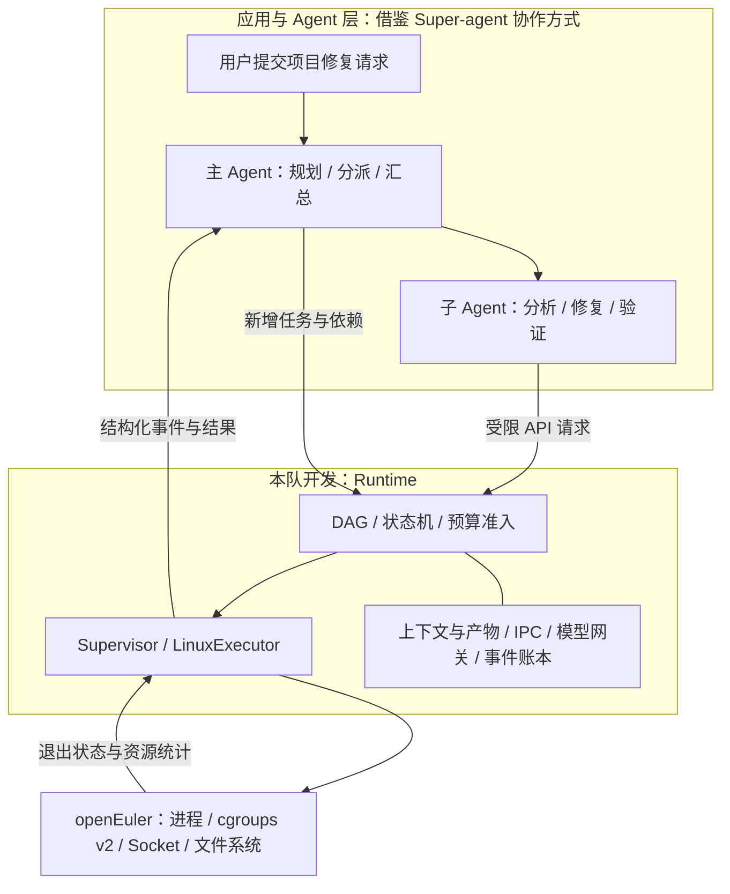
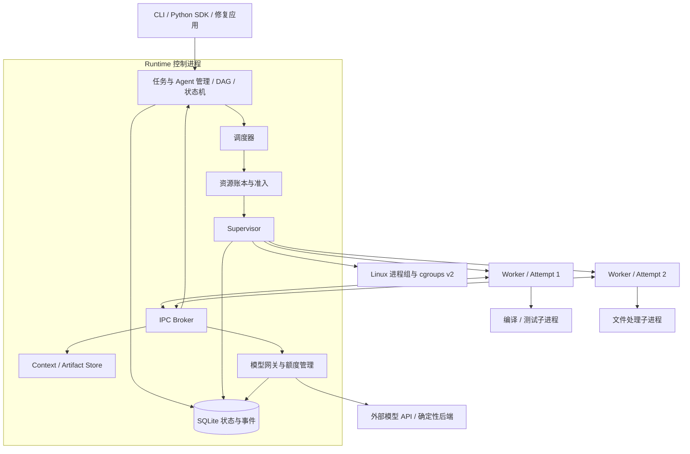

# Agent Runtime 参赛设计方案

版本：v1.1 · 定稿日期：2026-11-07 · 状态：已选定实施路线，核心机制待开发验证

基线仓库：`Tzddd6/agent-runtime`，`main` 提交 `d5ccaa692af26f480ec259a730caab09fe37bf24`。

本文面向三人团队、现有 NUC 与 openEuler 虚拟机，给出可以直接分工开发和验收的方案。除“现有实现”部分外，以下均为设计与计划；性能收益需要实验验证。

## 0. 本版定稿：Super-agent 式协作 + openEuler 资源运行时

**选定作品：基于 openEuler 的多智能体资源运行时。** 上层采用主 Agent 分派、多个 Worker 执行、事件回报的协作方式；中间实现本队的确定性 Runtime；下层通过 Linux 进程、cgroups v2、Unix Socket 和文件系统落实控制。保留 Python 原型，逐步拆分实现。

### 0.1 为什么选 openEuler，与系统的关联是什么

仓库所整理的赛题要求是在 openEuler、openKylin、OpenHarmony 等至少一个国内主流开源 OS 上开发，并非只允许 openEuler。本队已有 openEuler 虚拟机，继续使用它作为开发、集成、部署和实验主平台。

本方案对“操作系统级执行时”的实现选择是：在用户态建立 Agent 执行身份及策略，再将其映射到真实的进程、资源组和权限边界。赛题整理内容没有明确要求必须修改内核，因此本版采用已有 Linux 接口，不安排新增系统调用或内核调度器。这里是对给定要求的工程解释，不能据此保证评审结果。

openEuler 的 systemd/cgroup 与进程管理是实际执行底座；它与上层通过可调用的 LinuxExecutor 对接。使用通用 Linux 机制是合理的，兼容其他发行版也符合赛题鼓励方向。论文和答辩应陈述“在 openEuler 实现和验证”，不把通用机制包装为该发行版独有能力。[openEuler 官方服务管理文档](https://docs.openeuler.org/en/docs/26.09/server/administration/administrator/service_management.html) 描述了 systemd 与 cgroup 的服务生命周期管理；本机具体版本、内核和控制器能力需实际检测。

### 0.2 固定三层职责



图中的主 Agent、子 Agent 是逻辑角色，实际都作为 Runtime 管理的任务运行。主 Agent 本身也必须有执行期限和模型预算，不能在系统约束之外无限运行；CLI 先提交规划任务，Runtime 启动主 Agent 后才接收其动态派发请求。

第一版使用现成模型及提示词，不训练主 Agent。主 Agent 根据任务内容决定“做什么、依赖谁”，可提出资源档位；Runtime 根据配置和剩余额度决定“何时执行、最多使用多少资源”。初始仅提供 small/medium/large 等经测量校准的资源档位，模型不能直接写任意 cgroup 配置。限额、超时、OOM 处理和进程清理由普通确定性代码执行，不依赖模型做实时判断。

### 0.3 与 Super-agent 的对应关系

DeepSeek 公开原型采用 Engine、Assessor、Executor 等边界，其执行文档说明了独立会话、工作目录、并发槽位及后台工作生命周期。这里借鉴这种组织方式，重新实现适合比赛的精简结构；不直接假定某个会话已经对应独立 OS 进程或 cgroup，也不宣称该原型缺少本文未全面审查的其他能力。[公开架构说明](https://github.com/deepseek-ai/dsh-superagent-prototype/blob/main/docs/007-architecture.md)、[执行说明](https://github.com/deepseek-ai/dsh-superagent-prototype/blob/main/docs/003-execution.md)。

| 借鉴的概念 | 本队落地 | 与 OS 的明确连接 |
| --- | --- | --- |
| 主会话路由与分派 | Planner/Router Agent，提交受限任务 JSON | 规划过程也有 Worker 身份、预算和期限 |
| 执行会话与工作项 | Agent、Task、Attempt；一次 Attempt 一个 Worker | Attempt 对应 PID、进程组、cgroup、独立目录 |
| 并发槽位 | 本机资源准入 + 模型请求额度 | 本机资源由 cgroup 限制，外部模型由网关限制 |
| 事件触发与结果回流 | Broker + 统一 Event | Worker 退出、OOM、超时可生成系统事件 |
| 上下文与工作目录 | 不可变共享快照、私有增量、发布产物 | 内容存文件，控制消息传引用，读取经授权 |

系统侧的研究问题选定为：**多 Agent 混合调用外部模型与本地工具时，如何在本机有限资源下进行准入与调度，并在任务失败后完整回收执行资源。** 上下文引用与压缩作为配套机制，一并完成赛题覆盖和实验。

### 0.4 固定 OS 后端接口

```text
LinuxExecutor.launch(attempt_spec, limits) -> attempt_handle
LinuxExecutor.inspect(attempt_handle) -> status_and_usage
LinuxExecutor.cancel(attempt_handle) -> cancellation_status
LinuxExecutor.cleanup(attempt_handle) -> cleanup_result
```

`attempt_handle` 关联 Attempt ID、PID、进程组和 cgroup。launch 在配置并确认归组后才允许 Worker 执行实际任务；cleanup 仅在确认全部成员结束后报告资源可回收。系统事件和产物引用回到 Runtime，Runtime 更新状态，再按需向主 Agent 提供结果；不让模型高频读取 `/proc` 或直接发 kill 命令。

固定首选部署路线：由管理员安装 systemd 系统服务，为专用 Runtime 用户配置 `Delegate=yes`；Runtime 在委派子树内管理 Attempt cgroup。这样部署不依赖当前尚未验证的 user-session bus。服务配置、目标 systemd 版本和控制器委派仍须在 NUC 验收，不能把写好服务文件当作权限已经生效。[systemd 官方委派说明](https://systemd.io/CGROUP_DELEGATION/)。不同时让 systemd 和 Runtime 修改同一层 cgroup；具体层次见第 7 节。

### 0.5 固定演示与证据

主应用为小型 C/Python 项目缺陷修复：规划 → 并行分析与测试准备 → 修复 → 本地构建/测试 → 失败时新增修复任务 → 汇总。初始 4 个 Worker 上限、模型并发 2；CPU/内存总预算按实测校准，不凭模型自由扩大。

必须交付以下可复现演示：

1. 正常协作：主 Agent 动态建图，至少一次真实模型调用和真实编译/测试完成。
2. 资源准入：多个编译/测试任务竞争预算，超额请求排队或拒绝；实际 CPU/内存统计可查询。
3. 故障收敛：某个受限任务超内存或超时，清理其 Worker 和工具后代，独立分支继续完成。区分该任务 cgroup 内 OOM 与整机内存压力，不承诺任意系统 OOM 下其他进程绝对不受影响。
4. 上下文验证：同一项目快照以引用交给多个 Agent；测存储/IPC 字节，验证私有读取拒绝，并报告压缩前后 token 与验收结果。

本地 CPU/内存限制主要作用于 Worker、编译器、测试和文件处理程序；外部模型的推理发生在提供商侧。只并发发送 API 请求时，不能把远端模型速度变化归因为本机 cgroups。确定性系统实验与真实模型应用分开报告。

### 0.6 本周期已定取舍与三人职责

- 采用 Python 3.11、openEuler、单控制进程、多 Worker、Unix Socket、SQLite、本地对象文件。
- 不训练模型；不复制完整 Super-agent 产品及其消息平台接入；不修改内核；不做 GPU KV 共享或多机集群。
- A 负责 Planner 接入、任务/状态、DAG、调度、预算账本和集成；B 负责 LinuxExecutor、cgroup、进程与工具清理、IPC 传输和部署；C 负责 Agent 调用循环、模型网关、上下文、真实修复应用。
- 三人分别承担各自模块的验收、实验和文档。第一里程碑先完成“模拟任务接通 LinuxExecutor，配额生效且超时后代清理”，同时跑通最小真实模型调用；随后接动态任务与真实应用。

本节是实施选择；后文提供接口、状态、调度、上下文及实验细节。所有增强项服从 P0 七项要求与真实应用先完成的原则。

## 1. 项目定位与核心主张

**在 openEuler 上实现一个用户态多智能体运行时，将 Agent 的任务、执行进程、模型调用、工具调用与上下文统一纳入可调度、可限额、可恢复、可观测的执行体系。**

项目暂沿用 Agent Runtime 名称。操作系统侧工作集中在进程生命周期、cgroups 资源控制、IPC、故障收敛和数据共享；业务侧用“多智能体修复小型 C/Python 项目”证明其可用性。

推荐围绕一个问题组织答辩：**当多个 Agent 同时调用模型和工具时，如何在有限资源内运行、避免单个执行失败拖垮整体，并减少重复上下文开销？**

核心设计组合：

1. **统一执行账本**：用 Workflow、Agent、Task、Attempt、Invocation 串联依赖、OS 资源和调用记录。
2. **两层资源准入**：任务派发前预留本机资源；每次模型调用再申请模型额度，使 CPU/内存与外部 API 配额分别落实。
3. **上下文快照与引用通信**：共享材料不可变，Agent 保留私有增量，产物显式发布；IPC 优先传对象引用。
4. **按执行尝试收敛故障**：每次 Attempt 有独立工作目录、进程组和 cgroup，清理完成后才释放资源或重试。

这些机制是本队拟实现和验证的贡献，不预先声称算法首创。仅做 DAG 编排不足以体现本方案；最终演示必须出现真实资源限制、工具子进程清理、模型限额和上下文隔离证据。

## 2. 赛题覆盖与当前差距

赛题身份和要求以本仓库 [赛题要求](https://github.com/Tzddd6/agent-runtime/blob/d5ccaa692af26f480ec259a730caab09fe37bf24/docs/赛题要求.md) 为依据。该文件注明由赛题截图整理；最新规则仍应以区域赛官方通知为准。同名题目也出现在其他赛事，报名、联系人和提交日期不能混用。

| 赛题项 | 本方案落点 | 核心验收证据 |
| --- | --- | --- |
| 4.1 平台 | openEuler 为主平台；Windows 仅运行兼容原型 | 干净目标系统安装、运行、资源控制记录 |
| 4.2 调度 | 静态/动态 DAG、资源准入、等待老化 | 动态生成任务跑通；超额请求被拒绝或排队 |
| 4.3 抽象 | Agent 身份与 Task、Attempt、Invocation 分离 | 状态迁移和进程/cgroup/调用关联可查询 |
| 4.4 容错 | 独立进程、限时、清理、有限重试、失败传播 | 故障分支收敛；无关分支完成；无残留进程 |
| 4.5 上下文 | 不可变共享对象、私有增量、压缩回退 | 共享节省量、权限拒绝、压缩前后质量 |
| 4.6 应用 | 多 Agent 代码修复与测试反馈 | 真实模型、实际补丁、独立测试和执行轨迹 |
| 4.7 通信 | Unix Domain Socket Broker、消息与对象引用 | 延迟、字节数、背压和对端故障处理 |

### 2.1 现有实现

已阅读基线的 `README.md`、`docs/赛题要求.md`、参考目录说明及核心源码。目前具备：静态依赖校验、有限并发、每任务独立 Python 进程、超时结束 Worker、失败后跳过依赖分支，以及逐行 JSON 事件。动作只有 `echo/sleep/fail`。

本地对应源码执行 `python -X utf8 -m unittest -v`，现有三项测试通过：依赖环拒绝、超时、失败仅影响依赖分支。这只是当前原型验证，不代表目标系统新机制已验收。

当前代码存在的设计差距：

- `__main__.py` 同时承担校验、调度、监督和 CLI，需要逐步拆分。
- `process.kill()` 只处理 Worker 本身，没有工具后代清理保证。
- `max_workers` 只限制进程数，没有 CPU/内存/模型额度准入。
- 状态是内存字典，日志没有统一时间、Attempt、Invocation，也没有恢复语义。
- 当前临时文件输出和内存事件列表无显式容量边界，需要日志截断、磁盘预算及分页查询。
- 上下文、动态任务、双向 IPC、真实模型、重试均尚未实现。

### 2.2 范围分级

**P0：比赛核心。** 七项要求全部覆盖，至少一种真实模型 API、一种真实应用、确定性模拟后端、可复现实验。

**P1：核心完成后的增强。** Worker 热缓存与局部性调度、控制进程重启恢复、更精细的阶段资源调整。

本周期后置：多机集群、修改 Linux 内核、GPU KV Cache 共享、生成中抢占、通用恶意代码沙箱、多个框架完整适配和复杂 Web 前端。用户态实现边界与外部 API 方式应尽早向本赛题维护方确认，确认前不将其视为已获得官方认可。

## 3. 总体架构与技术选择



| 层次 | 选择 | 原因与边界 |
| --- | --- | --- |
| 控制面 | Python 3.11，单进程 asyncio 事件循环 | 便于三人实现；控制面不执行长耗时工具 |
| Worker | P0 每 Attempt 新建一个进程 | 沿用原型、隔离清晰；逻辑 Agent 身份跨进程保存 |
| Linux 管理 | subprocess、进程组、cgroups v2 | 真实限制与清理；需检查内核功能及委派权限 |
| IPC | AF_UNIX 流式 Socket，长度前缀 JSON | 可跨语言，便于抓取与调试，禁用 pickle |
| 状态 | SQLite，控制面单写 | 状态迁移与事件同事务；文件产物单独存储 |
| 上下文 | 本地不可变对象 + 元数据授权 | 先解决重复存储与消息拷贝，再评估压缩 |
| 模型 | 一种 API 适配 + Mock 后端 | 前者验证实际任务，后者验证运行时机制 |
| 展示 | CLI 状态、事件时间线、实验图表 | 开发资源优先投入机制与证据 |

同步网络请求、压缩、文件哈希和数据库批量操作通过有界执行队列或工作线程处理；不能在控制循环内执行长时间阻塞操作。模型调用并发和线程池并发均有上限。

本地记录中，NUC 为 i5-8259U、16 GB 内存，openEuler 虚拟机约 4 vCPU、7.3 GiB 内存；这些是用户此前提供的信息。初始配置建议：4 个 Worker 上限、任务总内存预算 4 GiB、CPU 预算 3000 millicpu、模型并发 2；实际运行后调整，为控制面和 OS 留余量。额度是初始工程参数，不是硬件保证。

## 4. 数据模型与生命周期

### 4.1 七类核心对象

| 对象 | 最少字段 | 对应关系 |
| --- | --- | --- |
| Workflow | id、owner、status、总预算、deadline、graph_version | 一次完整用户请求 |
| Agent | id、role、工具许可、私有上下文视图、status | 可独立识别的逻辑执行主体 |
| Task | id、agent_id、依赖、输入快照、资源请求、retry_policy | 可调度工作单元 |
| Attempt | id、task_id、序号、lease、pid、cgroup、开始/结束、错误 | Task 的一次执行 |
| Invocation | id、attempt_id、kind、状态、预算、用量、结果引用 | 一次模型或工具调用 |
| Context | object_id、hash、字节数、版本、ACL、来源 | 不可变输入或上下文片段 |
| Artifact | object_id、生产 Attempt、类型、发布状态 | 补丁、报告、测试输出等产物 |

Agent 与 Worker 分离：P0 的 Worker 执行一次 Attempt 后退出，同一 Agent 后续可由新进程承载，其身份与私有上下文由 Runtime 恢复。Worker 数与 Agent 数不要求相等。Agent P0 同时最多运行一个 Task，避免私有上下文并发写冲突。

### 4.2 状态规则

Task 主路径：

```text
WAITING_DEP -> READY -> DISPATCHING -> RUNNING -> SUCCEEDED
                                \-> RETRY_WAIT -> READY
RUNNING / DISPATCHING -> FAILED       （重试耗尽或不可重试）
WAITING_DEP -> SKIPPED                （必要前置最终失败）
非终态 -> CANCELLING -> CANCELLED    （先清理，再完成取消）
```

Attempt 独立记录 `STARTING/RUNNING/CLEANING/SUCCEEDED/FAILED/TIMED_OUT/CANCELLED`。超时是 Attempt 结局；Task 可重试或最终失败。`WAITING_LLM/WAITING_TOOL/RUNNING_TOOL` 是 Invocation/执行阶段，避免将 Task 所有子状态混在一起。

Agent 状态为 `REGISTERED/IDLE/BUSY/STOPPED`；一次 Attempt 失败不会自动让逻辑 Agent 永久失效。Workflow 默认等待所有分支收敛；必要输出成功且无必需任务失败才成功，允许失败的可选任务必须在提交时声明。

所有迁移由控制面单一入口执行。终态不可被后到消息改写；状态变更同时递增版本并写入事件。每个派发携带 Attempt lease，旧 Worker 的迟到成功或结果不能覆盖新 Attempt。

### 4.3 数据与事件一致性

SQLite 表建议为 `workflows/agents/tasks/edges/attempts/invocations/objects/grants/events/request_dedup`。状态表与关键事件同事务提交；派发先写 DISPATCHING，再启动 Worker，启动失败进行补偿清理。

产物先写临时文件、校验哈希并原子改名，再在事务中登记发布及 Task 成功；崩溃留下的未登记对象延后清理。数据库事务不能与远端模型调用构成原子事务，P0 不宣称外部调用恰好执行一次。

## 5. 动态 DAG 与任务接口

对外提供以下拟定接口，名称用于约定，当前尚未实现：

```python
submit_workflow(spec) -> workflow_id
register_agent(workflow_id, agent_spec) -> agent_id
spawn_batch(parent_attempt, request_id, tasks) -> task_ids
get_status(workflow_id) -> status_snapshot
cancel_task(task_id) -> cancellation_status
put_context(data, visibility) -> context_ref
get_context(context_ref, principal) -> data
invoke_model(request) -> invocation_id
publish_artifact(attempt_id, data, kind) -> artifact_ref
```

动态任务由业务 Agent 提议、Runtime 校验。模型输出先解析成受限 JSON，再检查身份、工具权限、数量、预算和依赖；不能直接执行模型给出的任意代码或让它修改数据库。

`spawn_batch` 为原子批次：允许依赖同工作流已存在节点及本批新节点；禁止未知依赖、重复 ID、环、跨工作流依赖，P0 不修改已存在节点的前置条件。校验通过后一次提交全部节点与边。用 `request_id` 去重，断线重发返回相同节点集合。

每工作流初始上限建议 100 个任务、最大修复轮数 2，均可配置。Agent 必须收到新增任务确认后才能上报自身完成；控制面在同一序列内处理新增和完成，防止最后一个任务先完成导致 Workflow 提前关闭。终态 Workflow 拒绝新任务。

修复闭环通过新增节点展开：`test_1 -> repair_2 -> test_2 -> review_2`。DAG 不添加回边。新任务依赖某个最终失败节点时应明确 SKIPPED 或拒绝提交，不允许永久等待。

## 6. 资源感知调度与模型网关

### 6.1 两层准入

本机任务资源向量定义为 `R_task=(worker_slot, cpu_milli, memory_bytes, pids)`；独立维护对象存储、日志与磁盘容量上限。

模型资源定义为 `R_model=(inflight_slot, requests_window, tokens_window, workflow_budget)`。模型并发不是 CPU 配额，API 模式也无法直接调度远端 GPU。

任务仅在依赖完成、Agent 空闲、资源可容纳时派发。单任务请求超过系统总预算时立即 `UNSCHEDULABLE`，不进入无限等待。检查与预留必须在同一调度临界区；启动失败、结束或取消由唯一清理路径释放一次。

P0 本机预算按整个 Attempt 保守预留，等待模型时仍保留 Worker 与内存预算，不声称能完全回收空闲资源。这牺牲部分利用率，但避免阶段切换的资源借还错误。P1 才考虑在调用边界调整 CPU 配额，内存未释放前不得从账本虚减。

模型请求到达网关后才申请模型槽位；排队不占模型执行槽，任务也不提前囤积模型额度。请求被本地取消后，若无法确认服务端已停止，记录远端用量未知及潜在计费，不能声称取消等于节省该次费用。

### 6.2 调度策略

保留三种可切换策略，所有策略共享相同的内核硬限制：

- `fifo`：就绪顺序派发，最前任务暂不能满足资源时等待，用作基线。
- `resource_fit`：按就绪顺序寻找可以放入剩余预算的任务，缓解队首阻塞。
- `resource_fit_aging`：资源适配 + 等待老化，作为推荐策略。

推荐策略的可执行定义：优先级取 0—10；`effective_priority = priority + floor(wait_seconds / aging_interval)`，默认 `aging_interval=5s`，同分按入队序号。每轮仅在可容纳候选中择优并原子预留。

单纯加分仍不能保证大任务不被小任务持续挤占，因此增加排空规则：某可满足总预算的任务等待超过 `starvation_threshold`（初始 30s）后，停止派发会阻碍该任务获得资源的新任务，等待既有 Attempt 结束后优先运行它。所有 Attempt 有总期限，保证排空有界；工作流整体取消可终止等待。

P0 不使用上下文局部性加分：每次新建进程，没有 Worker 间不同的持久缓存状态。P1 若改为常驻 Worker，再按“同权限域、对象版本、实际缓存字节”计算亲和性，并处理私有状态清空与缓存淘汰。

### 6.3 网关行为

网关负责统一超时、并发、速率、token 预算和 usage 记录。没有精确 tokenizer 时以明确标注的估算做准入，实际 token 以服务返回为准；不能将字符数直接标为准确 token。速率窗口和 token 限制按所接服务实际语义配置。

超时分为排队期限、请求期限和 Task 总期限。所有重试共用总期限。模型只对配置允许的瞬态错误做有限退避；超时后远端是否已执行不可确定，需保留该次可能重复计费记录。输出 schema 错误属于应用可处理错误，不能无上限重新调用。

工具通过参数数组和白名单程序启动，指定 Attempt 工作目录，限制输出、运行时长和可调用次数。P0 不开放任意 shell 拼接命令，API 密钥只放模型网关，不写入 Worker 日志和任务描述。

## 7. Linux 执行监督与故障收敛

### 7.1 cgroup 结构与启动顺序

```text
授权的 Runtime 子树/             （无进程的资源分发节点）
  control/                      （Supervisor 与网关）
  attempts/                     （无进程的资源分发节点）
    attempt-001/                （Worker 与全部工具后代）
    attempt-002/
```

启动前检测 cgroup v2、cpu/memory/pids 控制器、上级启用状态、委派写权限、`memory.swap.max`、`cgroup.kill` 等。严格模式缺能力则明确拒绝启动；兼容演示模式可降级，但必须标注未提供的控制能力，不能用于硬隔离验收。[Linux 官方文档](https://docs.kernel.org/admin-guide/cgroup-v2.html) 是接口依据。

建议顺序：创建 Attempt cgroup，写限额；创建只执行受信任启动代码的 Worker，让其阻塞等待启动许可；将其归组并核验 PID 所在 cgroup；最后发送开始执行信号。归组失败则终止并回收，禁止在加入限制前开始 Agent 或 fork 工具。后续工具继承 Worker 归组。

初始每任务示例：CPU 1000 millicpu 对应 `cpu.max=100000 100000`，内存上限 512 MiB，`pids.max=64`；内存与进程预算按任务类型调整。CPU 值表示带宽上限而非专属核心或性能保证。实验显式记录 swap 策略，避免交换空间掩盖预期 OOM 行为。

常规 Runtime 与 Worker 不默认以 root 身份运行。部署阶段应配置受限的资源委派，若确需特权 launcher，则接口仅允许受信任程序和指定子树操作，不能接受任意路径或任意提权命令。不同 Unix 身份/namespace 加固在目标系统逐步验证。

本版首选 systemd 系统服务委派：管理员创建专用 Runtime 用户并安装服务，设置 `User=agentrt`、`Delegate=yes`，服务停止时使用整个服务控制组的清理语义。Runtime 从自身归组信息发现获授权根目录，先把控制进程移到 `control/` 叶节点，再按上级实际许可启用 cpu/memory/pids 控制器、创建 `attempts/` 与各 Attempt 叶节点。禁止直接假定可操作 `/sys/fs/cgroup` 根，或随意改动其他服务的分组。配置说明依据 [systemd 委派文档](https://systemd.io/CGROUP_DELEGATION/)，安装命令与可用控制器以目标系统验收为准。

启动时必须验证服务身份、父级控制器、子级控制文件、实际写权限及运行后的归组。若检测失败，严格模式报出具体缺失项并停止派发；解决委派是部署里程碑，不把“使用 sudo 运行全部 Agent”作为最终方案。systemd 可用于控制进程重启与服务级清理，但自动恢复某个工作流的执行状态仍需单独协议，P0 不因此声称支持自动续跑。

### 7.2 结束与清理协议

1. 状态进入 CLEANING/CANCELLING，撤销当前 Attempt lease，阻止接受迟到产物。
2. 通知 Worker 协作停止；向对应进程组发送 TERM，等待有限宽限期。
3. 仍有后代时，优先使用该 Attempt 的 `cgroup.kill`；支持情况由启动检测确认。
4. 等待直接子进程回收及 cgroup `populated=0`，封存日志、退出码、OOM/限流统计。
5. 移除空 cgroup、关闭 IPC/文件句柄，再释放预算、安排重试和推进后继。

旧内核缺少 `cgroup.kill` 时可用进程组及 cgroup PID 清理作为兼容路径，但对持续 fork/脱离进程组等情况存在能力差异，应单独测试并标注。清理超时不能把资源当作已释放；隔离该槽位并报告 `CLEANUP_FAILED`，避免新旧任务叠用预算。

进程退出和心跳分别监测。初始心跳间隔 2s、失联阈值 10s；这只是异常信号，仍需区分事件循环阻塞、CPU 节流与进程退出。超时和正常完成竞争时由控制面按当前状态及 lease 决定唯一终态。

### 7.3 错误分类与重试

| 错误 | 默认处理 | 依赖影响 |
| --- | --- | --- |
| Worker 非预期退出 | 隔离清理；可重试任务最多重试 1 次 | 重试期间后继等待 |
| Attempt 超时 | 清理；纯计算可有限重试 | 耗尽后后继跳过 |
| 内存 OOM | 记录事件，默认不按相同配置盲目重试 | 最终失败明确传播 |
| 模型限流/暂时不可用 | 网关有限退避，受总期限约束 | 仍在当前调用内 |
| 编译/测试不通过 | 作为业务结果返回 | 应用生成下一轮修复 |
| 权限/非法 DAG/协议错误 | 拒绝，不自动重试 | 不污染已提交工作流 |
| 外部副作用完成情况不明 | 标记人工处理或失败 | 禁止自动重复执行 |

重试创建新 Attempt，不重写历史。内部编译、临时文件生成等可重放操作以独立目录隔离。向外发送消息、付款、发布等不属于本次演示工具，不能靠数据库去重声称具备外部恰好一次语义。

P0 要求 Worker 故障隔离与记录持久化；控制进程重启后自动续跑为 P1。P0 重启时先核对并清理遗留 Attempt，将未确认的执行记为 INTERRUPTED，而非自动记成功或无条件重放。

## 8. 上下文复用、隔离与压缩

### 8.1 存储与引用

上下文视图由三部分组成：`共享项目快照 + 当前 Agent 私有历史 + 明确授权的上游产物`。共享材料一经发布不可原位修改；更新生成新对象，Task 绑定具体版本，避免运行中读到变化材料。

内容用 SHA-256 校验，逻辑 `object_id` 与授权信息独立；同哈希不等于有读取权限。P0 优先在同工作流内去重，跨工作流复用需显式授权。共享文件可按需读取或只读 mmap，但 Python 解码与构建提示词仍可能复制数据，不能宣称完全零拷贝。

对象落盘由控制面管理；发布过程做大小限制与原子写入。Workflow 结束后按保留期清理，扫描时避开仍被活跃 Task/Attempt 引用的对象。设置存储总量、日志量及临时目录上限，防止磁盘耗尽影响控制面。

### 8.2 权限与隔离边界

Context API 根据连接绑定的 Workflow、Agent、Attempt 身份检查 grants，不能信任消息中自报的 `agent_id`。默认私有，显式 publish 后才可被其他 Agent 读取；私有历史更新只允许本 Agent，P0 不处理同 Agent 多任务并发修改。

协议级权限验证必须覆盖越权对象 ID、跨工作流访问、失效 Attempt、取消后的读取及不允许的发布。日志也应用相同访问边界，避免正文经日志泄漏。

若所有 Worker 使用相同 Unix 身份，API ACL 和工作目录约定仅是受协作代码遵守的逻辑隔离，不能抵御直接绕过 API 读文件的恶意进程。若答辩声称 OS 级私密隔离，就必须额外完成控制面/Worker 身份分离、文件权限或 mount namespace 等措施并做绕过测试。cgroups 本身只解决资源控制，不提供完整数据保密沙箱。

### 8.3 可回退的压缩

先实现可解释的提取式压缩：目标与约束置顶；保留最近若干轮对话；长测试日志提取失败用例、错误位置和退出码；历史正文保存原对象引用。代码上下文优先按文件/函数定位，不用随意字符截断关键代码。

记录压缩算法版本、输入/输出对象、估算或实际 token、耗时、遗漏风险。接近模型窗口上限或预算时触发，超过窗口且压缩后仍放不下则明确报错。遇到定位失败、引用缺失或验证失败，允许在总预算内扩大材料或回退原始上下文。

必须分开报告：对象复用减少的存储字节、引用传输减少的 IPC 字节、压缩减少的模型输入 token、真实任务质量变化。单纯减少本地重复存储不会自动减少远端输入 token 或费用；不将这些机制称为 KV Cache 共享。

## 9. IPC 与 Agent 协作

控制面 Broker 负责 Worker 通信和 Agent 邮箱，Worker 之间不直接建立全连接。P0 支持 `send_message(target_agent, artifact_ref)` 与受限的接收/查询；DAG 负责依赖就绪，邮箱负责有明确接收者的协作消息。

使用四字节网络序长度前缀 + UTF-8 JSON。帧体初始上限 64 KiB，大对象独立存储；大对象上传下载采用有界分块或流式传输，每块仍受限额约束，不能先将整个对象塞进控制消息。

```json
{
  "version": 1,
  "type": "task.spawn_batch",
  "request_id": "req-17",
  "workflow_id": "wf-1",
  "task_id": "plan",
  "attempt_id": "att-1",
  "lease": "opaque-attempt-lease",
  "payload": {"tasks": []}
}
```

连接首次握手使用派发时生成的短期凭据，绑定身份。协议与工具 stdout/stderr 分离，防止日志破坏消息解析。Socket 文件权限限制到 Runtime 使用者；凭据不写公开日志。

关键请求如动态建图、产物发布和结果提交有 request_id 去重记录；重复 ACK 不重复完成任务，过期 lease 拒绝。邮箱采用有界队列，消息 ID 去重与 ACK；投递失败、接收者结束和队列已满都返回明确错误，P0 不承诺任意断线下的恰好一次交付。

每连接限制队列字节数与请求数，控制消息/心跳保留独立容量；慢接收方触发背压、超时或断开，不阻塞整个控制面。禁止无期限阻塞的同步请求链，模型调用使用独立 Invocation ID 返回异步结果。

## 10. 真实应用：小型项目缺陷修复

```text
plan
 ├─ analyze_code ─┐
 └─ prepare_tests┼─> repair_1 -> build_and_test_1
                 │                    ├─ 成功 -> review
                 │                    └─ 失败 -> repair_2 -> build_and_test_2 -> review_2
```

角色建议为规划、代码分析、测试准备、修复、验证、审查六类。验证 Agent 主要运行确定性工具，其他角色按需要调用模型；不要求每个角色都单独使用一种模型。

规划产出受 schema 约束的任务描述，经校验后动态入图。分析与测试准备共享同一个只读项目快照，私有推理与消息分开保存。修复 Agent 发布补丁，验证 Agent 在独立项目副本应用补丁并运行构建/测试；多个 Worker 不修改同一份源代码树。

项目先选 10 个小任务，覆盖边界条件、参数检查、字符串处理和简单数据结构错误，每个有预先固定的验收测试。Agent 可新增测试，但不得修改用于计分的独立验收集。保存原始提交、补丁、运行环境、全部调用与验收输出。

演示必须包含：动态分叉和汇合、至少一次真实模型调用、真实工具运行、测试反馈形成新任务、一个可控故障及其他分支继续完成。任务没有修复成功也如实保留结果，不以“模型说修好了”作为通过标准。

建议 6—8 分钟演示：先看资源预算与任务图，再跑真实修复；随后使用可重复故障注入展示 Worker 超时、后代清理和独立分支；最后展示同一负载的基线/优化结果与已知局限。真实 API 延迟波动大，可准备标明录制条件的完整执行记录。

## 11. 实验与验收设计

### 11.1 必须先通过的功能与故障检查

| 类别 | 检查 | 通过条件 |
| --- | --- | --- |
| DAG | 静态/动态分叉汇合；非法环、未知依赖、重复请求 | 合法图完成；非法批次全部拒绝；重发不增节点 |
| 状态 | 超时与成功竞争、取消与发布竞争、旧 Attempt 回包 | 每 Attempt 唯一终态，无迟到覆盖和重复释放 |
| 资源 | CPU 密集、超内存、fork 超额、启动归组失败 | 配额和事件可观测；失败清理后预算准确 |
| 容错 | kill Worker、长工具、带后代工具、断 Socket | 后代收敛、独立分支继续、依赖不永久等待 |
| 上下文 | 同对象复用、私有对象、跨工作流、版本更新 | 字节计量正确，未授权拒绝，快照不漂移 |
| IPC | 半包、拆包、超长帧、慢接收方、重复消息 | 有界内存与队列，单连接异常不终止服务 |
| 模型 | 限流、超时、错误输出、预算耗尽、取消 | 并发不越界，重试有界，用量可追踪 |
| 应用 | 固定验收测试、补丁记录、修复轮数限制 | 实际执行结果决定成败，全部轨迹可复查 |

功能/故障通过标准是验收目标；当前只完成原型三项测试，不能将此表勾选为已完成。

### 11.2 两类负载分开测量

**确定性负载**：Mock 模型延迟、CPU/IO 工具、可控上下文大小、固定随机种子。分别测试窄 DAG 与宽 DAG、低/高共享材料、同质/异质资源请求；逻辑 Agent 取 4/8/16，Worker 上限单独记录。先选代表组合，每配置至少重复 5 次。

**真实应用**：固定模型标识、提供商、参数、提示词版本和 10 个缺陷任务，每任务至少重复 3 次；先计算预算。温度为零也不假定完全确定。记录时间、服务端错误及用量；不把 Mock 结果当成真实模型收益。

### 11.3 对照与消融

| 组别 | 调度 | 上下文 | 用途 |
| --- | --- | --- | --- |
| A | FIFO | 全量传输 | 内部基线 |
| B | resource_fit_aging | 全量传输 | 单独验证资源适配和公平性 |
| C | FIFO | 共享对象 + 引用 | 单独验证数据复用 |
| D | resource_fit_aging | 共享对象 + 引用 | 核心组合 |
| E | 与 D 相同 | 在 D 上启用压缩 | 单独验证压缩与质量代价 |

各组使用相同资源硬限制、模型与并发额度、超时/重试规则、输入和故障处理；只变指定机制。A 全量传输也必须使用安全分块及相同消息协议，避免用不可靠实现制造虚假优势。冷/热缓存分开标注。

真实应用再补一个相同模型、并发与工具限制下的直接并发执行对照。AIOS 先做架构/机制比较；只有能固定版本、运行等价任务与后端时才做端到端性能比较。禁止直接搬用其他项目的论文加速比作为本项目结果。

### 11.4 指标与统计口径

| 指标 | 口径 |
| --- | --- |
| 工作流完成时间 | 从提交接受至所有必要结果收敛，含排队/重试/清理 |
| 成功率 | 通过预置验收任务数 / 全部尝试任务数；失败和超时保留 |
| 吞吐 | 固定时间内完成工作流数，说明成功/全部的计数范围 |
| 排队/阶段耗时 | Task READY 到实际启动；模型排队、请求、工具执行分别计时 |
| p50/p95 | 说明样本单位；样本少时优先展示原始分布，不夸大尾延迟结论 |
| CPU / 内存 | cgroup CPU 时间、节流、memory.current；memory.peak 可用时记录 |
| 内存总峰值 | 对整个 Runtime 子树采样或使用其 peak；不能相加不同时间单任务峰值 |
| IPC / 存储 | 控制帧、对象内容传输、磁盘实际占用分开计量 |
| 模型用量 | 输入/输出 token、请求次数、估算与实际分列，费用按记录的单价计算 |
| 故障恢复 | 从注入至检测、清理、重新派发/工作流收敛分别记录 |
| 公平性 | 最大等待时长与大任务完成情况，含持续小任务注入实验 |
| 压缩效果 | token 比率、压缩耗时及验收通过率同时报告 |

环境文件记录 OS/内核、虚拟化、vCPU/内存、swap、Python/依赖、模型标识、网络条件、任务种子和仓库 SHA。Wall time 使用单调时钟计算，事件另存 UTC 时间用于串联；图表显示当地时间时注明时区。

性能目标先写为待验证假设：异质负载下改善队首阻塞；高共享材料下减少本机重复字节；故障下保持无关分支进展。报告均值、中位数及波动，负收益负载保留，不预填“提升 50%”。

## 12. 模块划分与实施顺序

建议目标目录如下，均为计划新增，现有入口应保留可运行：

```text
agent_runtime/
  __main__.py       CLI 与配置入口
  models.py         数据对象、枚举与校验
  task_manager.py   DAG、状态机、动态批次
  scheduler.py      FIFO、resource_fit_aging
  supervisor.py    启停、期限、重试、清理
  resources.py     资源账本、准入与释放
  linux/cgroup.py  控制器与进程组适配
  ipc/             协议、Broker、客户端
  context/         对象、授权、压缩与保留期
  gateway/         模型适配、额度、Mock
  tools.py         白名单工具执行
  storage.py       SQLite 与事件写入
  worker.py        单 Attempt Agent 执行
examples/code_repair/
benchmarks/         负载、故障、指标采集与原始结果
tests/              功能、集成、Linux 权限测试
docs/               设计、部署、实验、AI 使用记录
```

| 人员 | 主责 | 首先交付的接口与证据 |
| --- | --- | --- |
| A：任务与调度负责人，兼集成协调 | models、TaskManager、Scheduler、resources 资源账本、CLI、状态存储 | 状态/任务 schema、spawn_batch、原子预算预留/释放、图状态测试 |
| B：Linux 执行与隔离负责人 | Supervisor、cgroup 实际限制、IPC、Worker 启动与工具执行 | launch/cancel/cleanup、协议帧、配额和后代清理记录 |
| C：Agent 执行与上下文负责人 | 模型/工具交互循环、Context、模型网关、SDK 调用封装、修复应用 | context_ref、Mock/真实模型调用、上下文权限与压缩、独立验收集 |

这三块分别回答“谁先执行”“怎样受控执行”“执行时怎样调用模型和使用材料”。C 定义修复应用的角色与提示词，B 提供工具进程执行能力；A 的调度策略不负责业务规划。资源总账由 A 管理，B 负责将限额实际写入 cgroup 并报告清理结果，不能各自维护两套可用预算。

### 12.1 接口与协作边界

| 边界 | 提供方 | 使用方 | 必须先约定的内容 |
| --- | --- | --- | --- |
| TaskSpec / Attempt / Event | A 维护，三人共同确定 | B、C | 编号、依赖、输入引用、资源单位、期限、错误码、事件字段 |
| reserve / release | A | 调度器与 Supervisor 协作路径 | 原子预留、reservation_id、重复释放防护 |
| launch / cancel / cleanup | B | A | Attempt ID、资源限额、工作目录、清理是否完成、退出原因 |
| IPC 帧与消息 envelope | B | A、C | framing、请求 ID、lease、超时、最大消息、背压与错误响应 |
| context / model / Agent SDK | C | Worker 与示例应用 | 对象引用、授权、模型请求/结果、用量、调用期限 |

A 决定 Task 依赖、重试资格和最终状态；B 检测并上报 Attempt 退出、超时和清理结果，按策略执行终止/重启，不能自行绕过任务账本重复派发。C 的模型调用重试在 Invocation 内完成，仍受 Task 总期限与预算限制，避免两层重试相互放大。

A 负责主线集成协调，三人都提交可运行模块。B 与 C 先用固定消息和 Mock 对接，避免等待真实模型；A 可用假 Executor 开发调度，B 可用 sleep/CPU/内存负载开发隔离，C 可用直接调用和内存 Context 开发 Agent 循环。各自内部替身必须在集成时替换并做真实链路验收。

### 12.2 第一周如何开工

以下为从开工起七天的建议，不依赖具体星期：

| 阶段 | A | B | C | 共同交付 |
| --- | --- | --- | --- | --- |
| 第 1 天 | 提出 Task/Attempt/Event 最小结构 | 提出启动/终止事件和 IPC 字段 | 提出上下文与模型请求字段 | 用 60—90 分钟确定接口，提交一套固定输入输出样例 |
| 第 2—3 天 | 从现有 run 拆出 DAG、FIFO 和状态迁移 | 从现有代码拆出 Worker 启停、进程组清理 | 做 Mock/真实模型适配和最小上下文引用 | 保持旧演示可运行；新模块分别能独立运行 |
| 第 4—5 天 | 加本机资源账本，接 launch/结果事件 | openEuler 验证 CPU/内存限额、后代清理；连通基础 IPC | 让一个 Worker 通过网关调用模型，产出可引用结果 | 第一轮集成，不等所有高级功能完成 |
| 第 6—7 天 | 核对失败传播、状态和资源释放 | 注入超时、退出、启动失败，留存实际资源记录 | 运行 plan→并行分析/测试准备→review，保留调用用量 | 演示正常工作流与一条故障工作流，列出下一周缺口 |

首周验收以“真实链路接通”为目标；若 cgroup 委派权限未解决，B 明确记录阻塞点，其他两人继续开发，但不能把仅有进程组清理标为完整资源隔离。

### 12.3 实验、文档与评审共同承担

- A 负责调度基线、资源准入与等待公平性实验，并写抽象、DAG 和调度章节。
- B 负责 cgroup、进程后代清理、IPC 与故障实验，并写部署权限、执行隔离和容错章节。
- C 负责上下文/压缩、模型用量与真实任务实验，并写 Agent 执行、上下文与应用章节。
- 指标格式由三人先共同确定，C 可汇总图表与应用结果，但不包办全队测试和文档。集成问题按故障所在模块修复，A 负责推动复测。

建议每天一次简短同步，按“已完成、当前接口/阻塞、下一交付”说明；至少每两天合入一次可运行增量，每周一次集成演示。每人提交模块同时补自己的事件和测试；接口变更先改 schema 与示例。其他人须能按文档启动该模块，共享代码交叉评审，避免只有一人理解关键清理路径。

从 2026-11-05 起建议安排：

| 时间 | 工作与交付门槛 |
| --- | --- |
| 11/05—11/10 | 拆分原型；确定对象/协议；Supervisor 与 IPC 骨架；目标系统配额/权限试验；最小真实 API 调用 |
| 11/11—11/17 | 动态批次、资源准入、cgroup 启动与清理、有限重试；完成故障分支演示 |
| 11/18—11/24 | Context 共享/私有/发布、引用通信、模型网关；提取式压缩与回退 |
| 11/25—12/01 | 真实代码修复闭环、resource_fit_aging、基线与实验采集脚本 |
| 12/02—12/08 | 功能/故障验收、消融和真实任务实验，处理性能与稳定性问题 |
| 12/09—12/15 | 补缺陷和文档、干净环境复现、功能冻结 |
| 12/16—12/22 | 正式视频、材料与权限检查、按官方要求完成提交 |

12/22 是建议内部提交目标；此前备赛计划记载的官方期限需提交前重新确认。排期不是新的官方规则。

11/17 若核心资源/清理链路不稳，暂停 P1；12/01 若真实应用仍未跑通，停止优化扩展；12/15 后只修复、复现和材料。不能为做热缓存而放弃压缩、隔离或真实应用等必需覆盖。

## 13. 相关项目与本队贡献边界

| 参考 | 已核对的相关方向 | 本项目的取舍 |
| --- | --- | --- |
| [AIOS 论文](https://arxiv.org/abs/2403.16971v5) | 将调度、上下文、存储、访问等服务从 Agent 应用分离 | 借鉴 Runtime/SDK 分层；重点实现并评估目标 Linux 上的资源准入与故障收敛 |
| [LangGraph 官方概览](https://docs.langchain.com/oss/python/langgraph/overview) | 图状态编排、持久执行与流式控制等 | 可作为未来应用层适配；P0 用自有最小 DAG，避免引入两套状态管理 |
| [DeepSeek 公开原型](https://github.com/deepseek-ai/dsh-superagent-prototype) | 仓库级编码 Agent、独立工作项/会话/目录和事件接入 | 借鉴隔离工作目录及事件驱动应用方式；不把其应用架构直接当作 OS 资源机制 |
| [Linux cgroup v2](https://docs.kernel.org/admin-guide/cgroup-v2.html) | 资源控制、层级、委派与整组进程处理接口 | 直接复用内核能力，本队贡献是执行抽象、归组/清理协议和实验验证 |

上述是基于已读资料的设计判断，不代表全面比较了各项目全部功能。DeepSeek 仓库明确是研究原型，部分文章方向未实现；本文不依据转载文档中缺失的实验段落做性能主张。AutoGen、CrewAI 的仓库参考文件保留作后续阅读，当前不声称已完成其源码比较。

推荐最终贡献表述：**在目标国产 Linux 环境中，设计并实现具有统一执行账本、任务/模型两层资源准入、不可变上下文引用和按 Attempt 故障收敛的多 Agent 运行时，并通过同实现消融及真实应用验证适用范围。**

是否有相较现有工作的独特创新，需结合实际实现、固定版本源码比较和实验结论再定；“用了 cgroups”“用了 DAG”本身不作为独立创新结论。

## 14. 交付与下一步

最终交付应包含源码与许可证说明、依赖/配置、部署权限说明、架构与机制文档、自动化验收、实验原始数据及生成脚本、真实模型和 Mock 的区分、演示及 AI 工具使用记录。区域赛材料要求参考已有官方 PDF 留档并在提交前核对最新通知。

AI 使用记录至少保存工具/模型版本、使用目的、代表性提示词、采纳内容与人工验证方式；生成方案和代码的建议不应被记作已经运行的证据。借鉴或直接使用的第三方代码注明来源与许可。

**接下来第一个开发里程碑：** 保持当前演示可运行，拆出 Task/Attempt 模型、事件存储和 Supervisor；在 openEuler 跑通“两个并行任务，其中一个启动带后代的工具并超时，全部后代被清理，另一任务正常成功，预算归零”的集成案例。同时完成一个最小真实模型请求，尽早暴露网络、额度和接口问题。

这一里程碑完成后，再接动态任务与上下文，可以让后续功能建立在可控制、可测量的执行层上。

## 来源与核对记录

- 2026-11-05 通过 GitHub API 确认仓库为 public，默认分支 main，读取提交 `d5ccaa692af26f480ec259a730caab09fe37bf24`；2026-11-07 再次检查，main 仍为该提交。仓库内容为本方案的需求与现状依据。
- [基线 README](https://github.com/Tzddd6/agent-runtime/blob/d5ccaa692af26f480ec259a730caab09fe37bf24/README.md)、[核心调度原型](https://github.com/Tzddd6/agent-runtime/blob/d5ccaa692af26f480ec259a730caab09fe37bf24/agent_runtime/__main__.py)、[Worker](https://github.com/Tzddd6/agent-runtime/blob/d5ccaa692af26f480ec259a730caab09fe37bf24/agent_runtime/worker.py)。
- [区域赛官方入口](https://os.educg.net/#/index?TYPE=26OS_ZXHNF)：本次网页抓取未能加载其 JavaScript 赛题详情，因此未将同名其他赛事的联系人/日期替代本仓库记录。
- AIOS、LangGraph、DeepSeek 与 Linux 官方来源在第 13 节就近链接；正文的架构、参数、排期和实验门槛为本队实施建议。
